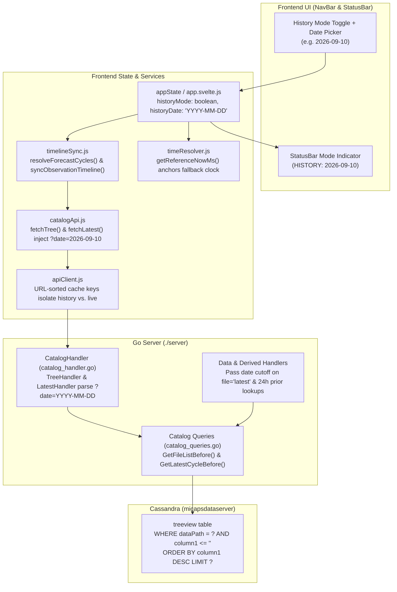

# History Mode Implementation Plan (`history-mode-plan1.md`)

## 1. Objective & Operational Concept

Currently, **MICAPS-Web** always queries the latest entries from Cassandra's `micapsdataserver.treeview` and `micapsdataserver.latestdatatime` tables.

We will add a **History Mode** that allows the user to select a target date (e.g., `2026-09-10`). When History Mode is active for `2026-09-10`:
- **Cutoff Boundary**: The server returns `treeview` file lists and resolves `latest` cycles strictly on or before **`2026-09-10 24:00`** (i.e., `<= 2026-09-10 23:59:59`, or `< 2026-09-11 00:00:00`).
- **Operational Semantics ("As if we work on that day")**:
  - **NWP Models**: Filtering is based on the **model initialization cycle date** encoded in the filename (e.g., `26091008.024` and `26091020.240` belong to `2026-09-10` and are included with all their forecast leads `+000h`..`+240h`, whereas `26091108.000` is from `2026-09-11` and is excluded).
  - **Observations / Radar / Satellite / Soundings**: Filtering is based on the **observation timestamp** encoded in the filename (e.g., `20260910200000.000`, `C006_20260910234500_FY4B.AWX`, `Z_OTHE_RADAMCR_20260910235400.BIN.BZ2` are included; `20260911000000.000` is excluded).
  - **Wall-Clock Reference & Staleness Engine**: The frontend's reference clock and timeline sync anchor to the selected historical date rather than `Date.now()`, preventing historical layers from being falsely marked as `hard-stale`.

---

## 2. End-to-End Architecture Overview



---

## 3. Backend Plan (`./server`)

### 3.1. Query Parameter Parsing & Validation (`server/handler/catalog_handler.go`)

1. Add a helper `parseHistoryDateParam(r *http.Request) (string, error)` that reads `r.URL.Query().Get("date")` (with fallback alias `before`):
   - Accepts `YYYY-MM-DD` (e.g. `"2026-09-10"`) or `YYYYMMDD` (e.g. `"20260910"`).
   - Validates via `time.Parse("2006-01-02", ...)` or `time.Parse("20060102", ...)`.
   - Returns normalized 8-digit string `"20260910"` (or `""` if not in History Mode).
   - Returns `400 Bad Request` if a non-empty `date` parameter is malformed.

### 3.2. Prefix-Aware CQL Range Slicing in `treeview` (`server/db/catalog_queries.go`)

#### Why naive querying fails:
- **Post-filtering alone fails**: `SELECT column1, value FROM micapsdataserver.treeview WHERE "dataPath" = '%s' ORDER BY column1 DESC LIMIT 100` only fetches the 100 newest files (e.g. October 2026). Filtering those in Go for `2026-09-10` would return 0 files.
- **A single static CQL bound fails across formats**: `micapsdataserver.treeview` stores `column1` as ASCII text sorted lexicographically, and different MICAPS tables use different filename conventions:

| Format Family | Example `column1` in `treeview` | Example `dataPath` | CQL Upper Bound for `2026-09-10` |
|---|---|---|---|
| **1. 4-Digit Year (`YYYYMMDD...`)** | `20260910200000.000`<br/>`20260910234800.JSON` | `SURFACE/PLOT_10MIN`<br/>`UPPER_AIR/PLOT/500`<br/>`WIND_PROFILER/ROBS/54511` | `column1 <= '20260910~'` |
| **2. 2-Digit Year (`YYMMDD...`)** | `26091020.024`<br/>`26091008.240` | `ECMWF_HR/TMP/500`<br/>`GRAPES_GFS/RAIN12`<br/>`CLDAS/RAIN01_BI_DATA_SOURCE` | `column1 <= '260910~'`<br/>*(Note: `'2026...' < '260910~'` in ASCII because `'0' < '6'`, so 4-digit and 2-digit year formats must be distinguished!)* |
| **3. Prefixed (`<PREFIX>YYYYMMDD...`)** | `C006_20260910234500_FY4B.AWX`<br/>`PRE_001_OTG_20260910_2300_FY2G.AWX`<br/>`FY2G_DST_RGB_20260910_1600.BMP`<br/>`Z_OTHE_RADAMCR_20260910234800.BIN.BZ2`<br/>`Z_SWAN_HAIL_NOWACASTING_20260910164200.TXT` | `SATELLITE/FY4B/L1/CHINA/C006`<br/>`SATELLITE/FY2G/L2/QPE001`<br/>`SATELLITE/FY2G/L2/DUST`<br/>`SWAN_PRODUCT/LOCAL/NCRAD/TDPRODUCT/MCR`<br/>`SWAN_PRODUCT/LOCAL/SEVERE_STORM/NOWCASTING/HAIL` | `column1 <= '<PREFIX>20260910~'`<br/>*(e.g. `'C006_20260910~'`)* |
| **4. Subdirectory Entries (`value = "D"`)** | `1000`, `850`, `500` | `ECMWF_HR/TMP` | Unbounded (level discovery) |

#### Algorithm for `GetFileList(client, dataPath, limit, beforeDate...)`:
1. **When `beforeDate == ""`**: Execute existing query unchanged.
2. **When `beforeDate != ""` (normalized as `YYYYMMDD`, e.g. `"20260910"`, with `YYMMDD = "260910"`)**:
   - **Step A — Resolve Partition Naming Pattern (Cached per `cPath` in `sync.Map`)**:
     - Check `pathPatternCache.Load(cPath)`.
     - On cache miss, peek at the latest row (`SELECT column1, value FROM micapsdataserver.treeview WHERE "dataPath" = '%s' ORDER BY column1 DESC LIMIT 1`).
     - Inspect `sampleName` and `value`:
       - If `value == "D"` or `sampleName` has no date digits (e.g. level directory `500`), classify as `patternDir`.
       - If `sampleName` starts with `(19|20)\d{6}`, classify as `patternYYYY` (bound = `YYYYMMDD + "~"`).
       - If `sampleName` starts with `\d{8}` (e.g. `26101408.024`), classify as `patternYY` (bound = `YYMMDD + "~"`).
       - If `sampleName` matches `^([A-Za-z0-9_.-]+?_)(?:19|20)\d{6}` (e.g. `C006_20261015...` or `Z_OTHE_RADAMCR_20261014...`), classify as `patternPrefixed` with `prefix` (bound = `prefix + YYYYMMDD + "~"`).
     - Store classification in `pathPatternCache`.
   - **Step B — Execute Bounded CQL Slice Query**:
     - For `patternDir`: query without `column1 <=` bound so level subdirectory discovery in `weatherLoader.js` continues to work.
     - Otherwise, execute:
       ```sql
       SELECT column1, value FROM micapsdataserver.treeview
       WHERE "dataPath" = '<cPath>' AND column1 <= '<bound>'
       ORDER BY column1 DESC LIMIT <limit>
       ```
   - **Step C — Go-Side Date Guard (`isFileOnOrBeforeDate(name, YYYYMMDD)`)**:
     - Extract the 8-digit `YYYYMMDD` date from each returned filename (handling `YYYYMMDD...`, `YYMMDD...` -> `20YYMMDD`, and embedded `_YYYYMMDD`).
     - Keep only entries where `fileDate <= YYYYMMDD` (or directory entries when `patternDir`).
     - Sort descending (`files[i].Name > files[j].Name`) and return.

### 3.3. Historical Latest Cycle Resolution (`GetLatestCycle` in `server/db/catalog_queries.go`)

Update `GetLatestCycle(client *CQLClient, dataPath string, suffix string, beforeDate ...string)`:
- **When `beforeDate == ""`**: Keep existing O(1) `latestdatatime` lookup + `treeview` fallback.
- **When `beforeDate != ""`**:
  - `latestdatatime` only holds the current real-time latest record. If its value happens to satisfy `isFileOnOrBeforeDate(val, beforeDate)`, return it.
  - Otherwise, call `GetFileList(client, dataPath, 50, beforeDate)`:
    - If `suffix` is specified (e.g. `"*.024"` or `"*.000"`), look for the first (newest) entry matching the suffix extension; if none matches that exact lead suffix, return `files[0].Name` (the newest file on or before `beforeDate`).

### 3.4. Data & Derived Handlers (`server/handler/*.go`)

1. **`CatalogHandler.TreeHandler` & `CatalogHandler.LatestHandler` (`server/handler/catalog_handler.go`)**:
   - Parse `beforeDate, err := parseHistoryDateParam(r)`.
   - Pass `beforeDate` to `db.GetFileList` and `db.GetLatestCycle`.
   - In `MockMode`: if `beforeDate != ""`, anchor synthetic timestamps at `YYYY-MM-DD 20:00:00 UTC` instead of `2026-08-29 20:00:00 UTC`, and return `"<YYMMDD>20.024"` in `LatestHandler`.
2. **`GridHandler`, `StationHandler`, `TLogPHandler`, `ImageHandler`, `ProfilerHandler`, `DerivedHandler`**:
   - When `file == ""` or `file == "latest"`, pass `beforeDate` from query params into `db.GetLatestCycle` and `db.GetFileList`.
3. **24h/48h Variation Prior-File Lookup in `DerivedHandler` (`server/handler/derived_handler.go`)**:
   - In `resolvePriorStationFile` (line 318) and `resolvePriorGridFile` (lines 511–522), when `GetBlob` exact match misses and `GetFileList(h.Client, path, 100)` is called to find the closest file near `targetTime`, pass `targetTime.Format("20060102")` as `beforeDate` to `GetFileList`.
   - This ensures that 24h temperature/pressure variation layers (`T-VARIATION-24H`, `SLP-VARIATION-24H`, etc.) find historical prior files in `treeview` when viewing historical dates.

---

## 4. Frontend Plan (`./client`)

### 4.1. Global State (`client/src/lib/stores/appCore.js` & `client/src/lib/stores/app.svelte.js`)

1. Add two fields to `createInitialAppState()` in `appCore.js`:
   ```js
   historyMode: false,
   historyDate: "", // "YYYY-MM-DD", e.g. "2026-09-10"
   ```
2. Export a pure helper `getActiveHistoryDate()` (e.g. from `appCore.js` or `appState.js`) that returns `appState.state.historyMode && appState.state.historyDate ? appState.state.historyDate : null`.

### 4.2. Catalog API & Automatic Cache Isolation (`client/src/api/catalogApi.js`)

1. In `fetchTree(path, limit = 100, optionsOrLevel = {}, levelArg = null)`:
   - Resolve `const date = options.date !== undefined ? options.date : getActiveHistoryDate();`
   - If `date` is non-empty, set `params.date = date`.
2. In `fetchLatest(path, suffix = "*.024", options = {})`:
   - Resolve `const date = options.date !== undefined ? options.date : getActiveHistoryDate();`
   - If `date` is non-empty, set `params.date = date`.
3. **Cache Isolation in `apiClient.js`**:
   - Because `buildUrl(endpoint, params)` in `apiClient.js` serializes and sorts all query parameters into the cache key, requests with `?date=2026-09-10` automatically get distinct cache keys from live requests and from other dates.

### 4.3. Forecast Cycle & Observation Timeline Resolution (`client/src/utils/timelineSync.js`)

1. **Cycle Cache Scoping**:
   - Scope `forecastCyclesCache` keys by `${path}@${historyDate || "latest"}`.
2. **`generateDynamicForecastCycles(base = null, count = 10)`**:
   - When `base === null`, check `getActiveHistoryDate()`.
   - If History Mode is active (e.g. `"2026-09-10"`), anchor `baseDate` at `2026-09-10 20:00` (`26091020`) and step backward in 12-hour increments (`26091020`, `26091008`, `26090920`, ...), instead of using `new Date()`.
3. **`resolveForecastCycles(model, element, level, forceRefresh)`**:
   - In History Mode:
     - Priority 1 (`fetchTree(path, 100)`): Extract actual cycles present in `treeview` on or before `historyDate` via `extractCyclesFromFiles(fileEntries)`. If only 1 cycle is returned in the 100-file slice (e.g., a model with >100 lead files per cycle), supplement with `generateDynamicForecastCycles(cycles[0], 10)`.
     - Priority 2 (`fetchLatest(path, "*.024")`): Passes `date=historyDate`, then generates cycles anchored at `latestStr` (clamped to `<= historyDate`).
     - Priority 3: Fallback to `generateDynamicForecastCycles(new Date("${historyDate}T20:00:00Z"), 10)`.
4. **`syncObservationTimeline(path, currentFile, winTitle, win, options)`**:
   - `fetchTree(path, 100, treeOpts)` automatically includes `date=historyDate`.
   - Filter `validFiles` as usual; if falling back to mock observation files when offline, generate mock observation filenames anchored at `historyDate` (`20260910200000.000`, `20260910170000.000`, etc.) instead of `DEFAULT_MOCK_OBS_FILES`.

### 4.4. Reference Clock & Staleness Alignment (`client/src/utils/timeResolver.js` & Loaders)

1. Add `getReferenceNowMs()` in `client/src/utils/timeResolver.js`:
   - When `historyMode && historyDate` (`YYYY-MM-DD`) is active, returns `Date.UTC(y, m - 1, d, 23, 59, 59)`.
   - Otherwise returns `Date.now()`.
2. Replace raw `Date.now()` cursor fallbacks with `getReferenceNowMs()` in:
   - `client/src/services/presetLoader.js` (line 271)
   - `client/src/services/weatherLoader.js` (lines 75, 79, 205) — and ensure `cursorTime` for observation products in `loadWeatherField` is re-evaluated after `syncObservationTimeline` sets `win.obsTime`.
   - `client/src/services/derivedContours.js` (lines 72, 290, 500, 610)
   - `client/src/lib/stores/timelineCore.js` (lines 22, 26, 266)
   - `client/src/components/LayersPanel.svelte`, `WindowPanel.svelte`, `LayerRow.svelte`, `StatusPanel.svelte`
3. **`MultiTrackTimeline.svelte` & Auto-Refresh Timer (`App.svelte`)**:
   - In `MultiTrackTimeline.svelte`: When `app.historyMode` is active, disable the 10-second `Date.now()` live-mode interval ticker and treat timeline mode as `"review"`.
   - In `App.svelte`: Skip the 60-second `forecastRefreshTimer` background poll while `app.historyMode` is active (since historical data before `YYYY-MM-DD 24:00` is static).

### 4.5. User Interface Design (`NavBar.svelte`, `StatusBar.svelte`, `App.svelte`)

1. **`NavBar.svelte` — History Mode Control Capsule**:
   - Place a compact control capsule in the navbar (`#nav-history-control`):
     - **Toggle Button (`#btn-history-mode`)**: Switches between `Latest` (live mode) and `History` mode.
     - **Date Input (`#input-history-date`, `<input type="date">`)**: Shown when History Mode is active (or clickable to activate History Mode directly), defaulting to today's date or the last selected historical date (e.g. `2026-09-10`).
     - **Quick Exit (`✕` / `Latest` button)**: One-click return to real-time Latest mode.
   - **Visual Styling**:
     - When History Mode is active, style the capsule with a distinct amber/gold accent (`rgba(210, 153, 34, 0.2)` background, `#d29922` border, `#e3b341` text) so the operator has an unmistakable visual cue that the workstation is time-traveling.
2. **`StatusBar.svelte` — Historical Mode Badge**:
   - In `.timeline-info`, when `app.historyMode && app.historyDate` is active, display a prominent amber badge `HISTORY · 2026-09-10` next to `NWP FORECAST` / `OBSERVATION`.
3. **`App.svelte` — `handleHistoryChange(enabled, dateStr)` Workflow**:
   - When the user selects a date or toggles History Mode:
     1. Update `app.historyMode = enabled` and `app.historyDate = dateStr`.
     2. Call `invalidateForecastCyclesCache()`.
     3. For all windows in `activeTab`:
        - Clear `win.forecastCycle = null`, `win.obsTime = null`, `win.obsFile = null`, `win._obsTimeline = null`, `win.wallClockCursor = null`.
     4. Reload active/visible windows:
        - If in split-screen with `autoAllocation !== "none"`, re-run `handleLoadData` on the base window (which cascades via `applyAutoAllocationModeToTab`), or reload each visible window with `loadPresetGroup`.
        - If a profile controller (`timeHeightController`, `lineHeightController`, `hovmollerController`, `tlogpController`) is active on a visible window, re-trigger its cycle/file resolution and reload its profile data.

---

## 5. File-by-File Change Summary

| File | Planned Responsibility |
|---|---|
| `server/db/catalog_queries.go` | Add `beforeDate` support to `GetFileList` and `GetLatestCycle`; implement prefix-aware CQL `column1 <=` bound construction + `isFileOnOrBeforeDate` filter and per-path pattern cache. |
| `server/handler/catalog_handler.go` | Parse & validate `?date=YYYY-MM-DD` (or `before`) in `TreeHandler` and `LatestHandler`; update MockMode generators to respect `beforeDate`. |
| `server/handler/grid_handler.go`<br/>`server/handler/station_handler.go`<br/>`server/handler/tlogp_handler.go`<br/>`server/handler/image_handler.go`<br/>`server/handler/profiler_handler.go` | Pass optional `date` query parameter when resolving `file == ""` or `file == "latest"`. |
| `server/handler/derived_handler.go` | Pass `date` query parameter on `latest` resolution; pass `targetTime` date cutoff to `GetFileList` in `resolvePriorStationFile` and `resolvePriorGridFile`. |
| `client/src/lib/stores/appCore.js`<br/>`client/src/lib/stores/app.svelte.js` | Add `historyMode` and `historyDate` state properties and `getActiveHistoryDate()` accessor. |
| `client/src/api/catalogApi.js` | Automatically pass `date` parameter in `fetchTree` and `fetchLatest` when History Mode is active. |
| `client/src/utils/timelineSync.js` | Scope cycle cache by `historyDate`; update `resolveForecastCycles`, `generateDynamicForecastCycles`, and `syncObservationTimeline` for historical dates. |
| `client/src/utils/timeResolver.js` | Add `getReferenceNowMs()` so cursor fallbacks and staleness calculations anchor to `historyDate 23:59:59Z` in History Mode. |
| `client/src/services/presetLoader.js`<br/>`client/src/services/weatherLoader.js`<br/>`client/src/services/derivedContours.js` | Use `getReferenceNowMs()` fallback and ensure `loadWeatherField` updates `cursorTime` after `syncObservationTimeline`. |
| `client/src/components/NavBar.svelte`<br/>`client/src/components/StatusBar.svelte`<br/>`client/src/App.svelte` | Render History Mode toggle & date picker in `NavBar`, status badge in `StatusBar`, and orchestrate multi-window reload on date change in `App.svelte`. |

---

## 6. Verification & Testing Plan

1. **Backend Unit Tests (`go test ./...`)**:
   - `server/db/catalog_queries_test.go`:
     - Test CQL upper-bound derivation for all 4 filename conventions (`20260910200000.000`, `26091020.024`, `C006_20260910234500_FY4B.AWX`, `Z_OTHE_RADAMCR_20260910164800.BIN.BZ2`, and `"D"` level directories).
     - Verify ASCII collision protection (ensuring `20261015000000.000` is never matched by `260910~`).
     - Test `isFileOnOrBeforeDate` boundary conditions (`2026-09-10` includes `26091020.240` and `20260910235959.000`, excludes `26091100.000` and `20260911000000.000`).
   - `server/handler/catalog_handler_test.go`:
     - Test `GET /api/catalog/tree?path=SURFACE/PLOT_10MIN&date=2026-09-10` and `GET /api/catalog/latest?path=ECMWF_HR/TMP/500&date=2026-09-10` in MockMode and with invalid date strings (`400 Bad Request`).
2. **Frontend Unit Tests (`bun test`)**:
   - Verify `fetchTree` and `fetchLatest` include `date=2026-09-10` when `historyMode = true` and omit it when `historyMode = false`.
   - Verify `resolveForecastCycles` and `syncObservationTimeline` return cycles/files `<= 2026-09-10`.
   - Verify `resolveLayerTime` marks a `2026-09-10` layer as `current` (not `hard-stale`) when History Mode is set to `2026-09-10`.
