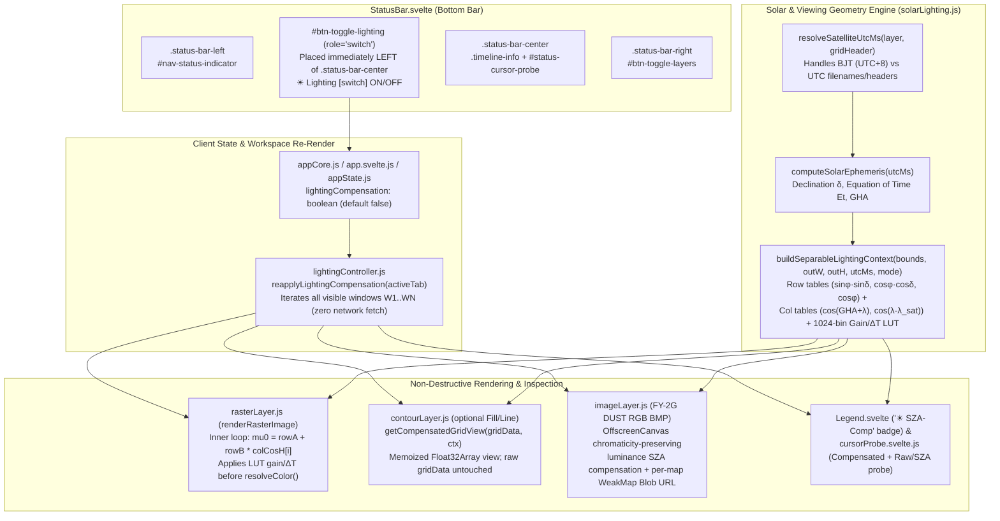

# Satellite Cloud & Water Vapor Lighting Compensation Plan (`lighting-compensation-plan1.md`)

## 1. Objective & Physical Problem Statement

In **MICAPS-Web**, satellite cloud and water-vapor imagery (`SATELLITE/FY4B/L1/CHINA`, `SATELLITE/FY4B/L1/DISK`, `SATELLITE/FY2G/L2/*`) currently renders raw calibrated sensor values directly through fixed colormaps (`ALBEDO`, `IR_TEMP`, `WV`, `CTT`, `DUST`) or raw RGB bitmaps without accounting for solar illumination geometry or geostationary slant-path viewing geometry.

As a result, **identical cloud or water-vapor structures render with markedly different brightness and colors** across:
1. **Different times of day** (*morning*, *nooning*, *evening*), and
2. **Different longitudes / regions at the same instant** (e.g., western China at **`lon 70°E`** vs. central China at **`lon 100°E`**, which differ by $\Delta\lambda = 30^\circ = \mathbf{2\text{ hours}}$ of local solar time, or up to $\mathbf{4\text{h } 40\text{m}}$ across China `70°E–140°E` and $\mathbf{8\text{h } 40\text{m}}$ across `FY-4B DISK` `70°E–200°E`).

### 1.1. Quantified Ground Truth on MICAPS-Web Satellite Data

Using the Spencer (1971) / NOAA astronomical solar position model at latitude $\phi = 35^\circ\text{N}$ (late October, $\delta \approx -13.1^\circ$, matching live Cassandra `bore.pub:59041` imagery on `2026-10-28`):

| Observation Time (`UTC+8` / `UTC`) | `lon 70°E` ($\mu_0 = \cos\theta_z$, SZA $\theta_z$) | `lon 100°E` ($\mu_0 = \cos\theta_z$, SZA $\theta_z$) | `lon 120°E` ($\mu_0 = \cos\theta_z$, SZA $\theta_z$) | Color Impact on Same $\rho = 75\%$ Cloud (`ALBEDO` Palette) |
|---|---|---|---|---|
| **Morning** `09:00 BJT` (`01:00Z`) | $\mu_0 = -0.158$ ($\theta_z = 99.1^\circ$, pre-dawn) | $\mu_0 = +0.239$ ($\theta_z = 76.2^\circ$) | $\mu_0 = +0.457$ ($\theta_z = 62.8^\circ$) | `70°E` pitch black (`0%`) vs `100°E` dark charcoal (`17.9%`) vs `120°E` medium gray (`34.3%`) |
| **Nooning** `12:00 BJT` (`04:00Z`, live `120000_FY4B` / `1200_FY2G`) | $\mu_0 = +0.431$ ($\theta_z = 64.5^\circ$) | $\mu_0 = +0.659$ ($\theta_z = 48.8^\circ$) | $\mu_0 = +0.671$ ($\theta_z = 47.9^\circ$) | `70°E` muted gray (`32.3%`) vs `100°E–120°E` bright silver-white (`49.4%–50.3%`, $1.55\times$ brighter) |
| **Afternoon** `16:15 BJT` (`08:15Z`) | $\mu_0 = +0.640$ ($\theta_z = 50.2^\circ$) | $\mu_0 = +0.415$ ($\theta_z = 65.5^\circ$) | $\mu_0 = +0.178$ ($\theta_z = 79.7^\circ$) | `70°E` bright (`48.0%`) vs `100°E` medium-dark (`31.1%`, $1.54\times$ dimmer) vs `120°E` dusk (`13.4%`, $3.6\times$ dimmer) |
| **Evening** `17:30 BJT` (`09:30Z`) | $\mu_0 = +0.520$ ($\theta_z = 58.7^\circ$) | $\mu_0 = +0.194$ ($\theta_z = 78.8^\circ$) | $\mu_0 = -0.080$ ($\theta_z = 94.6^\circ$, night) | `70°E` medium-bright (`39.0%`) vs `100°E` very dark (`14.6%`, $2.7\times$ darker) vs `120°E` black |
| **Midnight** `00:15 BJT` (`16:15Z`, [`awx_china_c006.bin`](file:///root/downloads/micaps-web/server/testdata/awx_china_c006.bin)) | $\mu_0 < 0$ ($\theta_z > 120^\circ$, night) | $\mu_0 < 0$ ($\theta_z > 135^\circ$, night) | $\mu_0 < 0$ ($\theta_z > 140^\circ$, night) | Measured in fixture `awx_china_c006.bin` (`AWXHeader2Geo` `16:15 UTC` = `00:15 BJT`): dark sensor floor `< 0.9%` (`DN 6..13`); night-side guard **must** keep $G = 1.0$ without amplifying dark noise |

In addition to direct $\cos\theta_z$ solar reflectance loss in **Visible / NIR / Cirrus-Vapor / SWIR (`C001–C006`)** and **RGB composites (`FY-2G DUST`)**, three additional physical effects shift cloud/vapor colors across time and longitude:
- **Hybrid MWIR Daytime Solar Reflection (`C007 · 3.75 µm`)**: Reflected solar radiance ($\propto \mu_0$) adds $+10\text{ to }+30\text{ K}$ to daytime cloud-top brightness temperatures $T_B$ at noon compared to morning/evening/night, shifting cloud colors across several stops of `IR_TEMP`.
- **Cirrus / Upper-Vapor Two-Way Slant Absorption (`C004 · 1.37 µm`)**: Solar photons traverse slant airmass $(1/\mu_0 + 1/\mu_v)$ through upper-tropospheric water vapor, causing extra low-sun attenuation on top of $\cos\theta_z$.
- **Emissive Water Vapor (`C008–C010 · 6.25–7.32 µm`) & Thermal IR (`C011–C015`, `FY-2G CTT`) Limb & Diurnal Bias**: For `FY-4B` stationed at $\lambda_{\text{sat}} = 133.0^\circ\text{E}$, viewing zenith angle increases from $\theta_v \approx 47^\circ$ at `lon 100°E` to **$\theta_v \approx 73^\circ$ (slant airmass $\sec\theta_v \approx 3.4$) at `lon 70°E`**, shifting water-vapor/IR weighting functions upward by $4\text{--}10\text{ K}$ (limb cooling — shifting an entire color band on `WV` / `IR_TEMP`), compounded in low-peaking `C010 (7.32 µm)` and window IR (`C011–C013`) by daytime solar surface-heating contrast.

### 1.2. Goals

1. **Channel-Aware Physical Lighting Compensation Engine**: Normalize solar zenith illumination ($\theta_z$) and geostationary viewing slant-path ($\theta_v$) effects per pixel $(\phi, \lambda, t_{\text{UTC}})$ according to each satellite channel's radiative physics, without ever altering non-satellite layers (NWP, radar, station plots, QPE) or mutating raw in-memory `layer.gridData`.
2. **Instant StatusBar Button-Toggle (`#btn-toggle-lighting`)**: Add an accessible workstation switch button **immediately to the left of `.status-bar-center`** in [`StatusBar.svelte`](file:///root/downloads/micaps-web/client/src/components/StatusBar.svelte), matching the existing `.toggle-switch-ui` + `.toggle-state-pill` (`ON`/`OFF`) design of `#btn-toggle-layers` across Dark, Light, and Brutalism themes.
3. **Zero-Network-Refetch Multi-Window Live Toggle (`< 15 ms`)**: Toggling Lighting Compensation ON/OFF re-renders all visible windows (including `2x2` / `4x2` split-screen morning vs. noon vs. evening comparisons) directly from in-memory `gridData` / cached image bitmaps using separable row/column trigonometry and 1D `Float32Array` lookup tables.

---

## 2. Current Codebase Audit (Verified `file:line`)

| Concern | Current File & Lines | Verified Behavior & Constraints |
|---|---|---|
| FY-4B 15-channel spectral metadata | [`client/src/utils/fy4bChannels.js:4-20`](file:///root/downloads/micaps-web/client/src/utils/fy4bChannels.js#L4-L20) | Maps channels `1..15` to `{ wl, band, desc }`: `1..3` `Vis`, `4` `NIR`, `5..6` `SWIR`, `7` `MWIR`, `8..10` `Vapor`, `11..14` `IR`, `15` `CO2`. |
| Satellite channel -> colormap routing | [`client/src/services/weatherLoader.js:450-459`](file:///root/downloads/micaps-web/client/src/services/weatherLoader.js#L450-L459), [`client/src/services/levelController.js:110-122`](file:///root/downloads/micaps-web/client/src/services/levelController.js#L110-L122) | `C001–C006` -> `ALBEDO` (`0..100%`), `C008–C010` -> `WV` (`190..275 K`), `C007` & `C011–C015` -> `IR_TEMP` (`180..320 K`). |
| Plate Carrée -> Web Mercator CPU rasterizer | [`client/src/layers/rasterLayer.js:149-271`](file:///root/downloads/micaps-web/client/src/layers/rasterLayer.js#L149-L271) | `renderRasterImage()` already computes `latGeo = mercatorYToLat(yMerc)` once per row `j` and `srcCol = srcColLookup[i]` per column `i`, then calls `resolveColor(val, data, dstIdx)`. Ideal zero-copy hook point for pixel-level compensation. |
| Geo-registered RGB BMP satellite layer | [`client/src/layers/imageLayer.js:28-104`](file:///root/downloads/micaps-web/client/src/layers/imageLayer.js#L28-L104) | Renders `/api/data/image?path=SATELLITE/FY2G/L2/DUST&file=...&format=png` over `bounds = [45, 5, 155, 55]` via MapLibre `image` source. |
| Timestamp timezone convention (`UTC+8` vs `UTC`, verified live on `bore.pub:59041`) | [`client/src/utils/timeResolver.js:298-331`](file:///root/downloads/micaps-web/client/src/utils/timeResolver.js#L298-L331), [`server/parser/awx_parser.go:360,574`](file:///root/downloads/micaps-web/server/parser/awx_parser.go#L360) | `parseTimestamp()` parses filename digits via `Date.UTC(...)` without timezone shift so UI displays `UTC+8`. **Verified live against Cassandra `bore.pub:59041`**:<br/>1. **All `.AWX` / `.HDF` / `.000` satellite filenames** — including **both `FY-4B`** (`C001_20261028121500_FY4B.AWX`) **and `FY-2G`** (`ANI_VIS_R04_20261028_1200_FY2G.AWX`, `CTT_MLT_OTG_20261028_1100_FY2G.AWX`, `PRE_001_OTG_20261028_1200_FY2G.AWX`, `AMV_IR1_OTG_20261028_0730_FY2G.AWX`, `DST_MLT_OTG_20261026_1500_FY2G.AWX`) — are **Beijing Time (`UTC+8`)** (`utcMs = parsedMs - 8h`).<br/>2. **Internal AWX binary headers** (`AWXHeader2Geo.Year..Minute` & `AWXHeader2Grid.StartYear..StartMinute`, serialized into `GridHeader.ValidTime` as `"…Z"`) are **already true `UTC`** (`04:00Z` when filename is `1200` / `120000`).<br/>3. **Exception (`FY2G_DST_RGB_*.BMP`)**: `FY2G_DST_RGB_20261028_0400.BMP` in `SATELLITE/FY2G/L2/DUST` uses **`UTC`** in its filename (`writetime = 04:38:56Z` = `12:38:56 UTC+8`). |
| AWX server calibration & channel header | [`server/parser/awx_parser.go:219-238,362`](file:///root/downloads/micaps-web/server/parser/awx_parser.go#L219-L238), [`server/handler/grid_handler.go:163-174`](file:///root/downloads/micaps-web/server/handler/grid_handler.go#L163-L174) | `awx_parser.go` checks `if h2.Channel == 4` for 64-bin visible LUTs and sets `Header.Element = fmt.Sprintf("C%03d", h2.Channel)` (which writes `"C004"` even for `C006`). Needs LUT auto-detection guard + channel code preservation from `dataPath`. |
| StatusBar DOM structure & existing tests | [`client/src/components/StatusBar.svelte:109-208`](file:///root/downloads/micaps-web/client/src/components/StatusBar.svelte#L109-L208), [`client/test/ui/global_theme_and_features.test.js:413-422`](file:///root/downloads/micaps-web/client/test/ui/global_theme_and_features.test.js#L413-L422) | `#status-bar` is a flex row with `.status-bar-left` (`#nav-status-indicator`), `.status-bar-center` (`.timeline-info` + `#status-cursor-probe`), and `.status-bar-right` (`#btn-toggle-layers`). Tests assert `leftContainerIdx < statusIndicatorIdx < rightContainerIdx < toggleLayersIdx`. |
| Theme overrides (`light` & `brutalism`) | [`client/src/styles/tokens.css:88,187,286-302`](file:///root/downloads/micaps-web/client/src/styles/tokens.css#L88), [`client/src/styles/polish.css:106,324`](file:///root/downloads/micaps-web/client/src/styles/polish.css#L106) | `.btn-toggle-layers` has explicit light/brutalism pill rules; `.toggle-switch-ui` and `.toggle-state-pill` are already globally themed. |
| Global reactive state store | [`client/src/lib/stores/appCore.js:2-42`](file:///root/downloads/micaps-web/client/src/lib/stores/appCore.js#L2-L42), [`client/src/lib/stores/app.svelte.js:22-33`](file:///root/downloads/micaps-web/client/src/lib/stores/app.svelte.js#L22-L33) | Fields in `createInitialAppState()` automatically sync bidirectionally between `app.<field>` (Svelte 5 rune proxy) and `appState.get("<field>")` / `appState.subscribe(...)`. |

---

## 3. End-to-End Architecture Overview



---

## 4. Physical & Mathematical Compensation Model (`client/src/utils/solarLighting.js`)

### 4.1. True Astronomical UTC Timestamp Resolution (`resolveSatelliteUtcMs`) — Verified on Live Cassandra (`bore.pub:59041`)

A naive implementation using `parseTimestamp(file)` directly as UTC would misplace the sub-solar point by $8\text{ hours} \times 15^\circ/\text{h} = \mathbf{120^\circ\text{ longitude}}$ on `FY-4B` and `FY-2G` `.AWX` imagery — and conversely, subtracting `8 hours` from `gridData.header.valid_time` would cause the opposite $120^\circ$ error because AWX binary headers already store UTC!

#### 4.1.1. Live Cassandra (`bore.pub:59041`) Ground-Truth Verification (`2026-10-28 04:37–04:57Z` / `12:37–12:57 UTC+8`)

| Cassandra `dataPath` | Live Filename (`column1`) | Cassandra `WRITETIME(value)` | Internal AWX Binary Header Time | Verified Filename TZ | Verified Header TZ |
|---|---|---|---|---|---|
| `SATELLITE/FY4B/L1/CHINA/C001` | `C001_20261028121500_FY4B.AWX` | `2026-10-28 04:37:08Z` (`12:37:08 UTC+8`) | `2026-10-28 04:15` (`AWXHeader2Geo`) | **`UTC+8`** (`12:15 BJT`) | **`UTC`** (`04:15Z`) |
| `SATELLITE/FY4B/L1/CHINA/C003, C004` | `C004_20261028120000_FY4B.AWX` | `2026-10-28 04:23:12Z` (`12:23:12 UTC+8`) | `2026-10-28 04:00` (`AWXHeader2Geo`) | **`UTC+8`** (`12:00 BJT`) | **`UTC`** (`04:00Z`) |
| `SATELLITE/FY2G/L1/VIS/EQUAL` *(+ all `FY2G/L1/*`)* | `ANI_VIS_R04_20261028_1200_FY2G.AWX` | `2026-10-28 04:33:12Z` (`12:33:12 UTC+8`) | `2026-10-28 04:00` (`AWXHeader2Geo`) | **`UTC+8`** (`12:00 BJT`) | **`UTC`** (`04:00Z`) |
| `SATELLITE/FY2G/L2/CTT` | `CTT_MLT_OTG_20261028_1100_FY2G.AWX` | `2026-10-28 03:51:16Z` (`11:51:16 UTC+8`) | `2026-10-28 03:00–03:25` (`AWXHeader2Grid`) | **`UTC+8`** (`11:00 BJT`) | **`UTC`** (`03:00Z`) |
| `SATELLITE/FY2G/L2/QPE001` *(+ `QPE003/006`, `TPW`, `CLC`, `TBB/IR1`)* | `PRE_001_OTG_20261028_1200_FY2G.AWX` | `2026-10-28 04:32:06Z` (`12:32:06 UTC+8`) | `2026-10-28 04:00–04:25` (`AWXHeader2Grid`) | **`UTC+8`** (`12:00 BJT`) | **`UTC`** (`04:00Z`) |
| `SATELLITE/FY2G/L2/AMV/IR1, IR3` | `AMV_IR1_OTG_20261028_0730_FY2G.AWX` | `2026-10-28 00:51:51Z` (`08:51:51 UTC+8`) | *(AWX Cat 2/3)* | **`UTC+8`** (`07:30 BJT`) | **`UTC`** (`23:30Z` prev day) |
| `SATELLITE/FY2G/L2/DUST` *(AWX series)* | `DST_MLT_OTG_20261026_1500_FY2G.AWX` | `2026-10-26 07:35:51Z` (`15:35:51 UTC+8`) | `2026-10-26 07:00` (`AWXHeader2Geo`) | **`UTC+8`** (`15:00 BJT`) | **`UTC`** (`07:00Z`) |
| `SATELLITE/FY2G/L2/DUST` *(RGB BMP series)* | `FY2G_DST_RGB_20261028_0400.BMP` | `2026-10-28 04:38:56Z` (`12:38:56 UTC+8`) | *(Gzipped BMP image, no AWX header)* | **`UTC`** (`04:00Z` = `12:00 BJT`) | N/A |

#### 4.1.2. Deterministic Resolution Rules in `resolveSatelliteUtcMs({ file, path, model, header, fallbackMs })`

1. **Tier 1 — Authoritative AWX Binary Header (`header?.discriminator === "AWX"` with valid `header.valid_time`)**:
   - Both `AWXHeader2Geo` (`awx_parser.go:360`) and `AWXHeader2Grid` (`awx_parser.go:574`) store **true UTC** and serialize `header.valid_time` as ISO-8601 `"YYYY-MM-DDTHH:mm:ssZ"`.
   - Therefore `Date.parse(header.valid_time)` returns exact `utcMs` directly (even when `file === "latest"` or `"AUTO"`).
2. **Tier 2 — FY-2G Dust RGB `.BMP` Filenames** (`/^FY2G_DST_(?:RGB|DUSTID)_\d{8}_\d{4}\.BMP$/i` or `.BMP` under `SATELLITE/FY2G/L2/DUST`):
   - Filename digits are **already UTC** (arriving ~36–38 min after each UTC hour on Cassandra): `utcMs = parseTimestamp(file)`.
   - *(Note: as an independent UI observation, `timeResolver.js` currently displays `FY2G_DST_RGB_20261028_0400.BMP` raw digits as `04:00 (UTC+8)` rather than `12:00 (UTC+8)`; lighting compensation uses the true `04:00Z` astronomical timestamp.)*
3. **Tier 3 — All `.AWX` / `.HDF` / `.000` Satellite Filenames (`*_FY4B.AWX`, `*_FY4A.AWX`, `*_FY2G.AWX`, `*_FY2G.HDF`, `*_HMW8.AWX`, `*_FY4A.000`)**:
   - Filename digits represent **Beijing Time (`UTC+8`)**: `utcMs = parseTimestamp(file) - 8 * 3600_000` (which matches Tier 1 `header.valid_time` to the exact minute).
4. **Tier 4 — Explicit ISO-8601 Strings with `Z` / Offset** (e.g., in unit tests or fallback metadata):
   - Respected verbatim via `Date.parse(...)`.

### 4.2. Solar Position & Separable Row/Column Factorization (Zero Inner-Loop Trig)

Given `utcMs`:
1. **Fractional Day-of-Year Angle $\gamma$** (Spencer 1971 / NOAA Solar Calculator, accuracy $< 0.03^\circ$):
   $$\gamma = \frac{2\pi}{365} \left( \text{DOY} - 1 + \frac{h_{\text{UTC}} - 12}{24} \right)$$
2. **Equation of Time $E_t$ (minutes) & Solar Declination $\delta$ (radians)**:
   $$E_t = 229.18\bigl(0.000075 + 0.001868\cos\gamma - 0.032077\sin\gamma - 0.014615\cos 2\gamma - 0.040849\sin 2\gamma\bigr)$$
   $$\delta = 0.006918 - 0.399912\cos\gamma + 0.070257\sin\gamma - 0.006758\cos 2\gamma + 0.000907\sin 2\gamma - 0.002697\cos 3\gamma + 0.00148\sin 3\gamma$$
3. **Greenwich Hour Angle $\text{GHA}_\odot$ (radians)**:
   $$\text{GHA}_\odot = \frac{\pi}{180}\left((h_{\text{UTC}} - 12)\times 15 + \frac{E_t}{4}\right)$$
4. **Separable Solar Zenith Cosine $\mu_0(\phi_j, \lambda_i)$**:
   $$\mu_0(\phi_j, \lambda_i) = \cos\theta_z = \underbrace{\bigl(\sin\phi_j \sin\delta\bigr)}_{A_j} + \underbrace{\bigl(\cos\phi_j \cos\delta\bigr)}_{B_j} \cdot \underbrace{\cos\bigl(\text{GHA}_\odot + \lambda_i\bigr)}_{C_i}$$
   - Precompute `colCosH[i] = Math.cos(ghaRad + lonRad_i)` once across `outWidth` ($O(W)$).
   - Compute `rowA = Math.sin(latRad_j) * sinDec` and `rowB = Math.cos(latRad_j) * cosDec` once per row `j` ($O(H)$).
   - **Inner pixel loop ($W \times H$ pixels)**: `const mu0 = rowA + rowB * colCosH[i];` — **1 multiply-add, 0 trig calls** (handles `FY-4B DISK` `lon ∈ [70°, 200°]` across the antimeridian seamlessly by $2\pi$-periodicity).
5. **Separable Geostationary Viewing Zenith Cosine $\mu_v(\phi_j, \lambda_i)$**:
   For spacecraft sub-satellite longitude $\lambda_{\text{sat}}$ (`FY-4B`: $133.0^\circ\text{E}$; `FY-2G`: $105.0^\circ\text{E}$) and orbital radius ratio $\eta = R_E / r_{\text{geo}} = 6371 / 42164 \approx 0.15110$:
   $$\cos\psi_{j,i} = \underbrace{\cos\phi_j}_{P_j} \cdot \underbrace{\cos(\lambda_i - \lambda_{\text{sat}})}_{Q_i}, \qquad \mu_v(\cos\psi) = \cos\theta_v = \frac{\cos\psi - \eta}{\sqrt{1 - 2\eta\cos\psi + \eta^2}}$$
   - Because $\mu_v$ depends solely on the 1D scalar $\cos\psi \in [0, 1]$, limb-cooling correction $\Delta T_{\text{limb}}(\cos\psi)$ is pre-tabulated into a 1024-entry `Float32Array` once; the inner loop performs **1 multiply + 1 array lookup**.

### 4.3. Channel-Aware Radiometric Dispatch Table

Every layer is classified via `classifyLightingMode(layer, element, level)` so each spectral regime receives physically valid compensation and non-satellite fields remain untouched:

| Mode | Matched Products / Channels | Physical Mechanism of Color Drift | Compensation Equation & Safeguards |
|---|---|---|---|
| **`reflective`** | **FY-4B `C001–C006`** (`0.47–2.25 µm` Vis, Vegetation NIR, `1.37 µm` Cirrus/WV NIR, `1.61–2.25 µm` Cloud-Phase SWIR) | Calibrated AWX reflectance $R_{\text{obs}} \approx \rho \cdot \mu_0$ scales linearly with $\cos\theta_z$ (plus slant vapor absorption on `C004`). | **Regularized SZA Normalization with Twilight Roll-off**:<br/>1. Spherical-atmosphere effective cosine: $\mu_{\text{eff}} = \sqrt{\mu_0^2 + \varepsilon_s^2}$ ($\varepsilon_s = 0.08$).<br/>2. Daylight gain ($\theta_z \le 76^\circ, \mu_0 \ge 0.242$): $G_{\text{day}}(\mu_0) = \min\!\bigl(G_{\max},\, \mu_{\text{eff}}^{-\alpha_c}\bigr)$, where $\alpha_c = 0.92$ for `C001–C003, C005–C006` (accounts for Mie forward scattering at high SZA), $\alpha_{C004} = 0.98$, and $G_{\max} = 4.2$.<br/>3. Twilight Hermite taper ($\theta_z \in [76^\circ, 88^\circ], \mu_0 \in [0.035, 0.242]$): $G(\mu_0) = 1 + S(t)\bigl(G_{\text{day}}(\mu_0) - 1\bigr)$ with $t = \frac{\mu_0 - 0.035}{0.242 - 0.035}$, $S(t) = t^2(3 - 2t)$ — prevents low-DN quantization noise (`DN = 3, 7`) along the terminator from blowing up into white streaks.<br/>4. Night side ($\theta_z \ge 88^\circ, \mu_0 \le 0.035$): $G = 1.0$ (no false noise amplification).<br/>5. Soft highlight knee above $85\%$ to $[0, 100\%]$ preserving cloud-top texture without flat clipping. |
| **`mwir_hybrid`** | **FY-4B `C007`** (`3.75 µm` Shortwave / Mid-Wave IR) | Daytime solar reflection adds $\Delta L_{\text{solar}} \propto \mu_0$ on top of thermal emission $B_{3.75}(T_B)$, warming apparent daytime cloud $T_B$ by $+10\text{--}25\text{ K}$ at noon vs. morning/evening. | **Planck-Domain Solar Excess Normalization**:<br/>Convert $T_B \to L = B_{3.75}(T_B)$ via fast 1D Planck LUT ($160\text{--}340\text{ K}$). For sunlit pixels ($\mu_0 > 0.05$) in liquid/mixed cloud regime ($T_B \in [235\text{ K}, 305\text{ K}]$), normalize the solar-reflected excess toward a uniform reference solar geometry ($\mu_{\text{ref}} = 0.5$, or damp diurnal solar excess by $\Delta L_{\text{corr}}(\mu_0)$) and invert $B_{3.75}^{-1}(L_{\text{comp}}) \to T_{B,\text{comp}}$, bounded to $\lvert\Delta T_B\rvert \le 18\text{ K}$. |
| **`vapor_ir_limb`** | **FY-4B `C008–C010`** (`6.25, 6.95, 7.32 µm` Water Vapor), **`C011–C015`** (`8.5–13.5 µm` IR / $\text{CO}_2$), **FY-2G `CTT`** | **Never divide Kelvin $T_B$ by $\mu_0$!** Instead: (a) geostationary slant airmass $(\sec\theta_v - 1)$ cools `lon 70°E` by $4\text{--}10\text{ K}$ relative to `lon 100°E–133°E`; (b) daytime solar insolation ($\max(0,\mu_0)$) warms semi-transparent background emission in low-peaking WV (`C010`) and window IR (`C011–C013`). | **Bounded Slant-Path Limb + Diurnal Background Compensation**:<br/>$$T_{B,\text{comp}} = T_B + \Delta T_{\text{limb}}(\theta_v, c) - \Delta T_{\text{insol}}(\mu_0, T_B, c)$$<br/>1. Limb darkening recovery: $\Delta T_{\text{limb}} = k_{\text{limb}}(c)\cdot \min\bigl(2.4,\, \sec\theta_v - 1\bigr)$ with channel absorption coefficients from operational radiative transfer ($k_{\text{limb}} \approx 3.2\text{ K}$ for `C008/C009` WV & `C014/C015`, $2.6\text{ K}$ for `C010` WV, $1.6\text{ K}$ for window `C011–C013`, $0\text{ K}$ for retrieved `L2/CTT`).<br/>2. Diurnal warm-background detrending (only on warm/semi-transparent pixels $T_B > 255\text{ K}$ in `C010–C013`): $\Delta T_{\text{insol}} = k_{\text{sun}}(c)\cdot (\mu_0^+ - \bar{\mu}_{\text{ref}}) \cdot w_{\text{warm}}(T_B)$ ($k_{\text{sun}} \approx 1.5\text{--}3.0\text{ K}$), leaving cold deep-convective cloud tops ($T_B < 240\text{ K}$) untouched. |
| **`rgb_image`** | **FY-2G `DUST` RGB BMP** (`type: "image"`, `SATELLITE/FY2G/L2/DUST`) & geo-RGB imagery | Direct RGB pixel brightness drops at low sun angles (morning/evening, `lon 70°E` vs `lon 100°E`). | **Chromaticity-Preserving Linear-Luminance SZA Compensation**:<br/>Decode sRGB $\to$ linear RGB, apply moderated SZA gain $G_{\text{rgb}}(\mu_0)$ ($\alpha = 0.65$, $G_{\max} = 2.6$, smooth twilight roll-off) equally across $(R_{\text{lin}}, G_{\text{lin}}, B_{\text{lin}})$ with Reinhard-style highlight roll-off $\frac{x \cdot g}{1 + x(g - 1)\cdot 0.35}$ so dust/cloud hue & saturation never clip or shift, then re-encode to sRGB. |
| **`none`** | All NWP models (`ECMWF_HR`, `GRAPES_*`, `CLDAS`, `NWFD_*`), `SWAN_PRODUCT` radar, `SURFACE`, `UPPER_AIR`, `FY-2G QPE`, `FY-2G AMV` | Geophysical / radar quantities independent of solar angle. | **Strict No-Op** (`return null` context; zero CPU overhead, zero pixel change). |

---

## 5. UI Design: Button-Toggle Left of `.status-bar-center`

### 5.1. DOM Placement in `StatusBar.svelte`

In [`client/src/components/StatusBar.svelte`](file:///root/downloads/micaps-web/client/src/components/StatusBar.svelte#L109-L185), place `#btn-toggle-lighting` inside a compact flex wrapper `.status-bar-lighting` **as the direct sibling immediately to the left of `<div class="status-bar-center">`**:

```
┌────────────────────────────────────────────────────────────────────────────────────────────────────────────────────┐
│ ● CASSANDRA :8000 │ [ ☀ Lighting (●─) ON ] │     OBSERVATION   Observation Time: 2026-10-16 16:15 (UTC+8) ...  │ [ Layers (─●) ON ] │
│ .status-bar-left  │ .status-bar-lighting   │                         .status-bar-center                        │ .status-bar-right  │
└────────────────────────────────────────────────────────────────────────────────────────────────────────────────────┘
```

Why this exact placement:
1. **Literal DOM & Visual Alignment**: `.status-bar-lighting` sits immediately left of `.status-bar-center`, symmetrically balancing `.status-bar-right` (`#btn-toggle-layers`) on the right of `.status-bar-center`.
2. **100% Backwards-Compatible with Existing Tests**: In [`global_theme_and_features.test.js:413-422`](file:///root/downloads/micaps-web/client/test/ui/global_theme_and_features.test.js#L413-L422), `leftContainerIdx < statusIndicatorIdx < rightContainerIdx < toggleLayersIdx` remains strictly satisfied.

### 5.2. Markup & Accessibility Specification

```svelte
  <!-- Lighting Compensation toggle button: placed immediately left of status-bar-center -->
  <div class="status-bar-lighting">
    <button
      id="btn-toggle-lighting"
      type="button"
      class="btn-toggle-lighting"
      class:active={app.lightingCompensation}
      role="switch"
      aria-checked={app.lightingCompensation}
      aria-label="Toggle Solar Lighting Compensation"
      title={app.lightingCompensation
        ? "Solar Lighting Compensation: ON (Normalizes sun-angle & slant-path cloud/vapor color differences)"
        : "Solar Lighting Compensation: OFF (Click to normalize morning/noon/evening & longitude sun-angle differences)"}
      onclick={toggleLightingCompensation}
    >
      <span class="lighting-icon" aria-hidden="true">
        <svg viewBox="0 0 16 16" width="13" height="13" fill="currentColor">
          <path d="M8 11a3 3 0 1 1 0-6 3 3 0 0 1 0 6zm0 1a4 4 0 1 0 0-8 4 4 0 0 0 0 8zM8 0a.5.5 0 0 1 .5.5v2a.5.5 0 0 1-1 0v-2A.5.5 0 0 1 8 0zm0 13a.5.5 0 0 1 .5.5v2a.5.5 0 0 1-1 0v-2A.5.5 0 0 1 8 13zm8-5a.5.5 0 0 1-.5.5h-2a.5.5 0 0 1 0-1h2a.5.5 0 0 1 .5.5zM3 8a.5.5 0 0 1-.5.5h-2a.5.5 0 0 1 0-1h2A.5.5 0 0 1 3 8zm10.657-5.657a.5.5 0 0 1 0 .707l-1.414 1.415a.5.5 0 1 1-.707-.708l1.414-1.414a.5.5 0 0 1 .707 0zm-9.193 9.193a.5.5 0 0 1 0 .707L3.05 13.657a.5.5 0 0 1-.707-.707l1.414-1.414a.5.5 0 0 1 .707 0zm9.193 2.121a.5.5 0 0 1-.707 0l-1.414-1.414a.5.5 0 0 1 .707-.707l1.414 1.414a.5.5 0 0 1 0 .707zM4.464 4.465a.5.5 0 0 1-.707 0L2.343 3.05a.5.5 0 1 1 .707-.707l1.414 1.414a.5.5 0 0 1 0 .708z"/>
        </svg>
      </span>
      <span class="lighting-label">Lighting</span>
      <span class="toggle-switch-ui" class:on={app.lightingCompensation} aria-hidden="true">
        <span class="toggle-thumb"></span>
      </span>
      <span class="toggle-state-pill" class:active={app.lightingCompensation}>
        {app.lightingCompensation ? "ON" : "OFF"}
      </span>
    </button>
  </div>
```

### 5.3. Theme & Responsive Styling (`StatusBar.svelte`, `tokens.css`, `polish.css`)

1. **`StatusBar.svelte`**:
   - `.status-bar-lighting` uses `display: flex; align-items: center; flex-shrink: 0;`.
   - `.btn-toggle-lighting` shares base geometry (`padding: 2px 8px; gap: 6px; font-size: 11px; border-radius: 4px;`) with `.btn-toggle-layers`, reusing `.toggle-switch-ui`, `.toggle-thumb`, and `.toggle-state-pill`.
   - When `.btn-toggle-lighting.active`: subtle solar-amber / workstation accent (`background: rgba(210, 153, 34, 0.16); border-color: rgba(210, 153, 34, 0.55); color: #e3b341;` in Dark theme) so the operator immediately distinguishes active radiometric compensation from panel visibility toggles.
2. **`client/src/styles/tokens.css` (Light Theme)**:
   - Add `[data-theme="light"] .btn-toggle-lighting` alongside `.btn-toggle-layers` (line 88) and `[data-theme="light"] .btn-toggle-lighting.active` (`background-color: rgba(154, 103, 0, 0.12); border-color: #d4a72c; color: #9a6700;`).
3. **`client/src/styles/polish.css` (Polish & Brutalism Theme)**:
   - Add `.btn-toggle-lighting` to shared control transitions (line 106), pill border-radius `#app .btn-toggle-lighting { border-radius: var(--radius-pill); }` (line 324), and Brutalism hard-border rules.

---

## 6. Client & Server Pipeline Integration Details

### 6.1. Global State & Persistence (`appCore.js`, `app.svelte.js`, `App.svelte`)

1. Add `lightingCompensation: false` to `createInitialAppState()` in [`client/src/lib/stores/appCore.js`](file:///root/downloads/micaps-web/client/src/lib/stores/appCore.js).
2. Add optional `onToggleLighting` callback prop on `StatusBar.svelte` (with default fallback toggling `app.lightingCompensation = !app.lightingCompensation` and invoking `reapplyLightingCompensation()`), wired in `App.svelte` so toggling updates all visible windows in the active tab immediately.

### 6.2. Fast In-Place Multi-Window Re-Render (`client/src/services/lightingController.js`)

Create `reapplyLightingCompensation(tabOrWindows)` to re-render active satellite layers across **all visible windows** (essential for `2x2` / `4x1` time-step or channel-step split-screen comparisons):
1. For each visible window `win` and its MapLibre instance `map = getMapInstance(win.id)`:
   - Iterate `getLayersForWindow(win)`.
   - Skip layers where `classifyLightingMode(layer) === "none"` (NWP, radar, stations, etc. are untouched!).
   - **If `layer.type === "image"` (`FY-2G DUST RGB`)**: call `loadImageLayer(map, layer, win)` which reads the cached raw `ImageBitmap` / PNG and swaps between raw URL (`OFF`) and compensated Blob URL (`ON`).
   - **If `layer.gridData` is present (`FY-4B C001–C015`, `FY-2G CTT`)**:
     - Build `lightingOpts = buildLayerLightingOptions(layer, win, app.lightingCompensation)`.
     - If `layer.config?.showRaster && layer.visible !== false`: call `renderGridRaster(map, layer.gridData, layer.element, layer.colormap, { layerId: layer.id, opacity: layer.config?.opacity ?? 0.85, status: layer.status, isSoftStale: layer.isSoftStale, isHardStale: layer.isHardStale, lighting: lightingOpts })`.
     - If `(layer.config?.showFill || layer.config?.showLine) && layer.visible !== false`: pass `effectiveGrid = app.lightingCompensation ? getCompensatedGridView(layer.gridData, lightingOpts) : layer.gridData` to `renderContourLayers(...)`.
     - Update the window's legend entry (`updateLegend(...)` with `lightingCompensated: Boolean(app.lightingCompensation && lightingOpts?.mode !== "none")`).
2. Refresh `cursorProbe` if `cursorProbeState.active` so hovered status-bar values update immediately.

### 6.3. Raster, Image, Contour, Probe & Legend Hooks

1. **[`client/src/layers/rasterLayer.js`](file:///root/downloads/micaps-web/client/src/layers/rasterLayer.js)**:
   - In `renderRasterImage(..., options)`:
     - When `opts.lighting?.enabled && opts.lighting?.mode !== "none"`:
       - Call `const lightSampler = createSeparableRasterLighting(opts.lighting, leftLonRaw, rightLonRaw, outWidth, srcColLookup, nlon);` before the row loop (`O(W)` setup).
       - At the top of each row `j` (where `latGeo` is already computed at line 223): `const rowLight = lightSampler.prepareRow(latGeo);` (`O(H)` setup).
       - Inside the inner pixel loop (line 266, right before `resolveColor(val, data, dstIdx)`): `val = rowLight.apply(i, val);` (`1` multiply-add + `1` `Float32Array` LUT read, `< 4 ms` total for 2.4M pixels).
2. **[`client/src/layers/imageLayer.js`](file:///root/downloads/micaps-web/client/src/layers/imageLayer.js)**:
   - Track compensated Blob URLs and render sequence numbers per `map` instance via `WeakMap` (matching `rasterLayer.js` §8.8.3 split-mode safety) and cache decoded raw `ImageBitmap` / image elements keyed by `url` (LRU capped at 12 frames).
   - When `app.lightingCompensation` is `true` and `classifyLightingMode(layer) === "rgb_image"`, render compensated pixels via `OffscreenCanvas` / `<canvas>` and pass the Blob URL to `map.getSource(srcId).updateImage({ url: blobUrl, coordinates })`; when `false`, revoke the Blob URL and pass the original `/api/data/image?...` URL.
3. **[`client/src/services/weatherLoader.js`](file:///root/downloads/micaps-web/client/src/services/weatherLoader.js), [`overlayTriggers.js`](file:///root/downloads/micaps-web/client/src/services/overlayTriggers.js), [`configActions.js`](file:///root/downloads/micaps-web/client/src/ui/layers/configActions.js), [`contourReRender.js`](file:///root/downloads/micaps-web/client/src/services/contourReRender.js)**:
   - Attach `lighting: buildLayerLightingOptions(layerMeta, win)` whenever rendering satellite rasters or contours so timeline stepping, channel switching (`C001..C015`), palette switching, and pan/zoom re-renders consistently honor `app.lightingCompensation`.
4. **[`client/src/lib/stores/cursorProbe.svelte.js`](file:///root/downloads/micaps-web/client/src/lib/stores/cursorProbe.svelte.js)**:
   - When `app.lightingCompensation` is `true` on a satellite layer, format hovered values with both compensated and raw/SZA context, e.g. `C002: 68.4% (raw 47.7%, SZA 45.8°)` for reflective bands or `C008: 236.2K (raw 232.8K)` for limb-compensated WV bands.
5. **[`client/src/components/Legend.svelte`](file:///root/downloads/micaps-web/client/src/components/Legend.svelte) & [`legendCore.js`](file:///root/downloads/micaps-web/client/src/lib/stores/legendCore.js)**:
   - Propagate `lightingCompensated: boolean` on legend items; when `true`, display a compact pill `☀ SZA` next to `.legend-time-badge` so screenshots and operational displays self-document active compensation.

### 6.4. Server-Side Companion Hardening (`server/parser/awx_parser.go` & `server/handler/grid_handler.go`)

While lighting compensation itself executes 100% client-side, two small server parser fixes (verified against live `bore.pub:59041` `C003_20261028120000_FY4B.AWX` and `C004_20261028120000_FY4B.AWX`, both of which store `h2.Channel = 4` and `cal[0,63,64,1023] = [0, 12000, 12000, 12000]`) ensure all 15 FY-4B channels feed accurate physical metadata to the client:
1. **Reflective 64-Bin LUT Detection ([`server/parser/awx_parser.go:219`](file:///root/downloads/micaps-web/server/parser/awx_parser.go#L219))**:
   - Currently checks `if h2.Channel == 4`. Generalize to `isReflectiveAWXChannel(h2.Channel, calibRaw)` (`h2.Channel == 4 || (h2.Channel >= 1 && h2.Channel <= 6 && calibRaw[0] < 1000 && calibRaw[64] == calibRaw[1023] && calibRaw[63] > 0)`) so any FY-4B reflective channel (`C001–C006`) storing either legacy `4` or its AGRI channel index `1..6` in `h2.Channel` decodes the 64-entry `0..120%` albedo LUT accurately.
2. **Preserve Requested AGRI Channel Code in `GridResponse.Header.Element` ([`server/handler/grid_handler.go:235`](file:///root/downloads/micaps-web/server/handler/grid_handler.go#L235))**:
   - When `dataPath` ends with `/C001`..`/C015`, set `gridResp.Header.Element = targetChannel` (instead of leaving `"C004"` from legacy `h2.Channel`), ensuring `gridData.header.element` unambiguously identifies `C001..C015` (so `C004` `1.37 µm` cirrus/vapor uses $\alpha_{C004} = 0.98$ while `C001–C003, C005–C006` use $\alpha_c = 0.92$).

---

## 7. File-by-File Change Summary

| File | Planned Responsibility |
|---|---|
| `client/src/utils/solarLighting.js` *(new)* | Pure astronomical solar position (`computeSolarEphemeris`), BJT vs. UTC timestamp resolver (`resolveSatelliteUtcMs`), channel mode classifier (`classifyLightingMode`), separable row/column raster & RGB samplers (`createSeparableRasterLighting`, `compensateRgbImageData`), and non-mutating memoized grid view (`getCompensatedGridView`). |
| `client/src/services/lightingController.js` *(new)* | Workspace-wide live re-render coordinator (`reapplyLightingCompensation`, `buildLayerLightingOptions`) across single and multi-window split layouts with zero network requests. |
| `client/src/lib/stores/appCore.js`<br/>`client/src/lib/stores/app.svelte.js` | Add `lightingCompensation: false` to initial app state and expose reactive toggle helpers. |
| `client/src/components/StatusBar.svelte` | Add `.status-bar-lighting` + `#btn-toggle-lighting` (`role="switch"`, sun icon, `Lighting` label, `.toggle-switch-ui`, `.toggle-state-pill` `ON`/`OFF`) immediately left of `.status-bar-center`. |
| `client/src/styles/tokens.css`<br/>`client/src/styles/polish.css` | Add Light, Dark, and Brutalism theme rules for `.btn-toggle-lighting` matching `.btn-toggle-layers`. |
| `client/src/App.svelte` | Wire `StatusBar` lighting toggle handler to `reapplyLightingCompensation` for all visible windows in the active tab. |
| `client/src/layers/rasterLayer.js` | Integrate `createSeparableRasterLighting` into `renderRasterImage()` row/column loop when `options.lighting?.enabled` is active. |
| `client/src/layers/imageLayer.js` | Add offscreen-canvas chromaticity-preserving SZA compensation + per-map `WeakMap` Blob URL lifecycle for geo-registered RGB satellite BMP/PNG layers (`FY-2G DUST`). |
| `client/src/services/weatherLoader.js`<br/>`client/src/services/overlayTriggers.js`<br/>`client/src/ui/layers/configActions.js`<br/>`client/src/services/contourReRender.js` | Pass `lighting` context options to `renderGridRaster`, `renderBinaryRaster`, `renderContourLayers`, and `updateLegend` across initial load, timeline steps, channel switches, palette changes, and viewport re-renders. |
| `client/src/lib/stores/cursorProbe.svelte.js`<br/>`client/src/lib/stores/legendCore.js`<br/>`client/src/components/Legend.svelte` | Show compensated + raw/SZA readout in live cursor probe and `☀ SZA` indicator pill in active satellite legends. |
| `server/parser/awx_parser.go`<br/>`server/handler/grid_handler.go` | Harden 64-bin reflective LUT detection across `C001–C006` and preserve exact `C001–C015` channel identifier in `GridResponse.Header.Element`. |
| `client/test/lighting_compensation.test.js` *(new)*<br/>`server/parser/awx_parser_test.go` | Unit, integration, UI DOM, and empirical fixture benchmarks. |

---

## 8. Phased Implementation & Verification Plan

### Phase 1 — Solar & Slant-Path Physics Engine + Unit Verification
- Implement `client/src/utils/solarLighting.js` and `server/parser/awx_parser.go` / `grid_handler.go` channel hardening.
- **Unit Tests (`bun test client/test/lighting_compensation.test.js` & `go test ./server/...`)**:
  1. **Timezone Accuracy (Cassandra-Verified Rules)**:
     - `C004_20261028120000_FY4B.AWX` (`UTC+8` filename) -> `2026-10-28T04:00:00Z`.
     - `ANI_VIS_R04_20261028_1200_FY2G.AWX`, `CTT_MLT_OTG_20261028_1100_FY2G.AWX`, and `DST_MLT_OTG_20261026_1500_FY2G.AWX` (`UTC+8` FY-2G `.AWX` filenames) -> `2026-10-28T04:00:00Z`, `2026-10-28T03:00:00Z`, and `2026-10-26T07:00:00Z` respectively.
     - `header: { discriminator: "AWX", valid_time: "2026-10-28T04:00:00Z" }` with `file: "latest"` -> `2026-10-28T04:00:00Z` (no double `-8h` subtraction on already-UTC AWX binary headers).
     - `FY2G_DST_RGB_20261028_0400.BMP` (`UTC` FY-2G Dust RGB `.BMP` filename) -> `2026-10-28T04:00:00Z`.
  2. **Diurnal & Longitudinal Invariance (`lon 70°E` vs `lon 100°E`, Morning / Nooning / Evening)**: Feed a synthetic uniform cloud deck ($\rho_{\text{true}} = 70\%$, observed as $R_{\text{obs}} = \rho_{\text{true}}\cdot\mu_0(\phi, \lambda, t)$) at `09:00 BJT`, `12:00 BJT`, and `16:15 BJT` across `70°E..125°E`; assert compensated reflectance $R_{\text{comp}}$ converges within $\pm 3\%$ across all sunlit points ($\theta_z \le 75^\circ$).
  3. **Terminator & Night-Side Stability**: Assert gain tapers smoothly across $\theta_z \in [76^\circ, 88^\circ]$, never exceeds $G_{\max} = 4.2$, and equals $1.0$ for $\theta_z \ge 88^\circ$ (no `NaN`, `Infinity`, or blown-up dark noise).
  4. **Real CMA Nighttime Fixture Guard (`awx_china_c006.bin`)**: Parse [`server/testdata/awx_china_c006.bin`](file:///root/downloads/micaps-web/server/testdata/awx_china_c006.bin) (`header.valid_time = "2026-10-14T16:15:00Z"` = `00:15 BJT` midnight across China, dark floor `< 0.9%`); verify `resolveSatelliteUtcMs` resolves `16:15Z` (not `08:15Z`) and night-side guard leaves all dark-floor pixels unamplified ($G = 1.0$).
  5. **Channel Isolation**: Assert `C008–C010` (`WV`) and `C012` (`IR`) never divide $T_B$ by $\mu_0$ (bounded $\lvert\Delta T_B\rvert \le 10\text{ K}$, positive limb recovery at `lon 70°E` relative to `lon 100°E`), and NWP `ECMWF_HR/TMP` / `SWAN_PRODUCT` return exact bit-identical values whether `lightingCompensation` is `true` or `false`.

### Phase 2 — Raster, Contour, RGB Image, Probe & Legend Integration
- Wire `solarLighting.js` and `lightingController.js` into `rasterLayer.js`, `imageLayer.js`, `weatherLoader.js`, `overlayTriggers.js`, `configActions.js`, `contourReRender.js`, `cursorProbe.svelte.js`, and `Legend.svelte`.
- **Verification**:
  - Verify `layer.gridData.values` remains 100% unmutated after toggling `OFF -> ON -> OFF` (round-trip bit identity).
  - Verify per-map `WeakMap` Blob URL isolation in `2x2` split-screen mode (morning in `W1`, noon in `W2`, afternoon in `W3`, evening in `W4`).
  - Benchmark `renderRasterImage` with compensation enabled on a $1751 \times 1001$ grid: compensation overhead must remain `< 10 ms`.

### Phase 3 — StatusBar Toggle UI & Theme Verification
- Add `#btn-toggle-lighting` immediately left of `.status-bar-center` in `StatusBar.svelte` with Dark, Light (`tokens.css`), and Brutalism (`polish.css`) styling, wired in `App.svelte`.
- **UI & Regression Tests (`bun test`)**:
  - Assert `#btn-toggle-lighting` exists in `StatusBar.svelte` with `role="switch"`, `aria-checked`, `.toggle-switch-ui`, `.toggle-state-pill`, and DOM index strictly before `class="status-bar-center"` (`statusIndicatorIdx < toggleLightingIdx < centerContainerIdx < rightContainerIdx < toggleLayersIdx`).
  - Run full test suites (`cd client && bun test` and `cd server && go test ./...`) to confirm zero regressions across all existing StatusBar, theme, split-window, and satellite tests.
