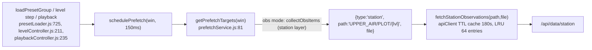
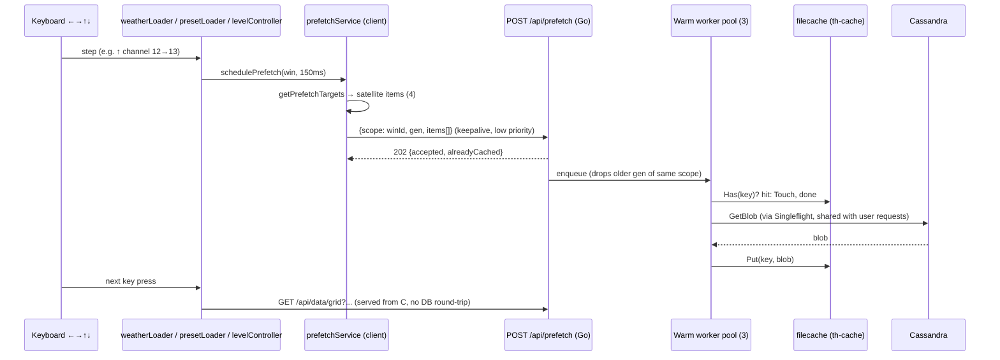

# Satellite Prefetch Plan (`satellite-prefetch-plan1.md`)

## 1. Objective

Make keyboard navigation on **satellite** windows feel as instant as it does on the *500 hPa Sounding Station Plots* preset. Prefetch the four neighbours of the current view:

| Key | Satellite meaning | Neighbour to warm |
|---|---|---|
| `←` prev | previous scan time | same channel, previous file in the window's obs timeline |
| `→` next | next scan time | same channel, next file in the window's obs timeline |
| `↑` up | next channel (`levels[idx+1]`, `stepVerticalLevel(+1)`) | channel `N+1` at the **same** timestamp |
| `↓` down | previous channel (`levels[idx-1]`) | channel `N-1` at the **same** timestamp |

The prefetch must **warm a file cache in the backend** (`server/th-cache`, `filecache.Cache`). It must not flood the browser heap with decoded satellite grids.

Scope:
- FY-4B AGRI `SATELLITE/FY4B/L1/{CHINA,DISK}`, 15 channels, `hasLevel:true`, `type:"contour"` with raster rendering.
- FY-2G AWX products `SATELLITE/FY2G/L2/*` (CTT, QPE, AMV), `hasLevel:false`, so time axis only.
- FY-2G Dust RGB `type:"image"` (`/api/data/image`, BMP to PNG), time axis only.

---

## 2. Current State (verified in code)

### 2.1 How the 500 hPa Sounding Station Plots prefetch works today (reference)



- Left/Right come from `getAdjacentTimeSteps()`, fed by the live per-window resolver registered in `App.svelte` (`setLiveTimelineResolver`).
- Up/Down step `VERTICAL_LEVELS` (`[1000…100]`), so `500 → 400/700`.
- The only cache is the **browser** TTL cache in [`apiClient.js`](file:///root/downloads/micaps-web/client/src/api/apiClient.js).
- [`station_handler.go`](file:///root/downloads/micaps-web/server/handler/station_handler.go) has **no** `filecache` usage. There is no backend cache for this preset today.

### 2.2 Why satellite gets nothing today

I ran `getPrefetchTargets()` against the `preset-fy4b_china_grouped` preset (win level 12, obs timeline with prev/next files). Result:

```json
{"left":{"items":[]}, "right":{"items":[]}, "up":{"level":400,"items":[]}, "down":{"level":700,"items":[]}}
```

| # | Gap | Location |
|---|---|---|
| G1 | `collectObsItems()` only handles `layer.type === "station"` / `"tlogp"`. FY-4B layers are `type:"contour", model:"SATELLITE"` and FY-2G Dust is `type:"image"`, so every direction returns `items: []`. | [`prefetchService.js:294-348`](file:///root/downloads/micaps-web/client/src/services/prefetchService.js#L294-L348) |
| G2 | Up/Down always step the hard-coded `VERTICAL_LEVELS`. FY-4B presets carry `levels:[1..15]`. Channel 12 is not in the pressure list, so `idx=-1` falls back to index 4 and gives bogus `400/700`. The real key handlers already use `activeGroup.levels`. | [`prefetchService.js:159-209`](file:///root/downloads/micaps-web/client/src/services/prefetchService.js#L159-L209) vs [`App.svelte:2216-2219`](file:///root/downloads/micaps-web/client/src/App.svelte#L2216-L2219), [`levelController.js:29-31`](file:///root/downloads/micaps-web/client/src/services/levelController.js#L29-L31) |
| G3 | The channel file name is channel-prefixed (`C012_20261028121500_FY4B.AWX`) and the server path gets `/C012` injected. Nothing in the client builds the sibling-channel file name. | [`grid_handler.go:100-122,154-163,177-190`](file:///root/downloads/micaps-web/server/handler/grid_handler.go#L100-L122) |
| G4 | The prefetch fetch call drops `level`. The real load calls `fetchGridData(path, file, targetLevel)` ([`weatherLoader.js:441`](file:///root/downloads/micaps-web/client/src/services/weatherLoader.js#L441)), which adds `&level=`. Prefetch calls `fetchGridData(item.path, item.file)`, so the URL, and therefore the `apiClient` cache key, differs. `isCached()` also omits `level` and `date`. This affects NWP grids as well as satellite. It does not affect Sounding Station Plots, because that real load passes no `level`. | [`prefetchService.js:405-446`](file:///root/downloads/micaps-web/client/src/services/prefetchService.js#L405-L446) |
| G5 | Satellite grids are big. [`awx_parser.go:276`](file:///root/downloads/micaps-web/server/parser/awx_parser.go#L276) auto-decimates only to `≤1800` px per side and notes a "160MB JSON" risk. `MAX_DATA_CACHE_ENTRIES=64` counts entries, not bytes. Prefetching 4 decoded neighbours into the browser cache is a heap hazard (see `progress/memory-optimization-plan1.md`). | [`apiClient.js:40`](file:///root/downloads/micaps-web/client/src/api/apiClient.js#L40) |
| G6 | Backend cache layout is inconsistent. Grid caches the raw blob at `(table, subDataPath, file)`, with singleflight. Image caches at `("SATELLITE", fullDataPath, file)`, with **no** singleflight, and re-decodes BMP to PNG on every request. | [`grid_handler.go:215-249`](file:///root/downloads/micaps-web/server/handler/grid_handler.go#L215-L249), [`image_handler.go:107-136`](file:///root/downloads/micaps-web/server/handler/image_handler.go#L107-L136) |
| G7 | **Up/Down resets the step length to 3h and jumps to the latest scan (user-reported bug, fixed).** Reproduced against the real `syncObservationTimeline`. Three defects: (a) `loadWeatherField` called it with `forceLatest: !isTimeStep`. A level/channel step is also `isTimeStep=false`, so it was treated as a fresh load and reset `win.stepLength` to `defaultStep` (3h) and picked the latest file. (b) Its hand-rolled `validSteps` (`[1,3,6,12,24]`) omitted the satellite 15 min step, so `0.25` was coerced to 3h even without `forceLatest`. (c) The kept file is matched by exact name, but a channel step changes the prefix (`C012_…` to `C013_…`), so the old file never matched and the time position jumped to latest. | [`weatherLoader.js:156-158`](file:///root/downloads/micaps-web/client/src/services/weatherLoader.js#L156-L158), [`timelineSync.js` `syncObservationTimeline`](file:///root/downloads/micaps-web/client/src/utils/timelineSync.js) |

---

## 3. Design Decision

> [!IMPORTANT]
> **Satellite prefetch is backend-warm, not browser-warm.** The client tells the server which blobs it is likely to need next. The server fetches them from Cassandra into `th-cache` and returns **no payload**. When the user presses a key, the normal `/api/data/grid` or `/api/data/image` request is served from the local disk cache. That removes the Cassandra round-trip, which is the dominant cold cost, without holding multi-MB decoded grids in browser memory.

Alternatives considered:

| Option | Verdict |
|---|---|
| A. Reuse today's path: extend `collectObsItems` and call `fetchGridData` per neighbour. | Rejected, and not kept as a flag (decision 3). It warms the server cache only as a side effect, and it downloads and parses the full decoded grid ×4 into the JS heap (G5). |
| **B. New server-side warm endpoint (chosen).** | Small request, no response payload, bounded concurrency, dedupes with real requests via `Singleflight`. |
| C. Server-side prediction with no client hint. | Rejected. The server cannot know the window's step length, channel list, or history date. |

---

## 4. Architecture



Key properties:
- **One canonicalisation.** The warm path and the real request path derive the cache key from the same function, extracted from `fetchGrid` (§5.1). The channel-prefix rewrite is the main reason a mismatch would silently defeat the cache.
- **One singleflight.** A user request arriving while a warm job is in flight joins it instead of issuing a second Cassandra read.
- **Best-effort.** Failures never surface to the UI. Missing blobs go into a short negative cache so held keys do not hammer Cassandra.

---

## 5. Backend Changes (`server/`)

### 5.1 Extract shared blob resolution (behaviour-preserving refactor)

New [`server/handler/blobref.go`](file:///root/downloads/micaps-web/server/handler/blobref.go):

```go
type BlobRef struct {
    Table, SubDataPath string // cache key parts
    DataPath, File     string // Cassandra directory + file (as passed to db.GetBlob)
}

// CanonicalGridRef applies FY-4B channel injection (grid_handler.go:100-122, 154-163)
// and channel-prefix normalisation (177-190), then splits Table/SubDataPath.
// Pure function: no DB, no 'latest' resolution (callers pass explicit files).
func CanonicalGridRef(path, file, level string) (BlobRef, error)

// Shared by grid + image + warm: cache.Get → Singleflight.Do(GetBlob → Put).
func (c *BlobSource) GetOrFetch(ref BlobRef) ([]byte, error)
```

- `GridHandler.fetchGrid` is rewritten to call `CanonicalGridRef` for the non-derived, non-`latest` branch. The `latest` resolution (`db.GetLatestCycle`) stays in place and runs **before** canonicalisation, as it does now.
- `ImageHandler.fetchAndConvertImage` moves to `GetOrFetch`. This adds the missing singleflight (G6).
- **Cache-key unification for the image path.** Today it is `("SATELLITE", "SATELLITE/FY2G/L2/DUST", file)`. Moving to `Table="SATELLITE", SubDataPath="FY2G/L2/DUST"` matches the grid layout. The old entries are orphaned and age out under the 6h TTL and the byte cap. No migration is needed.

### 5.2 `filecache` additions ([`cache.go`](file:///root/downloads/micaps-web/server/filecache/cache.go))

| Method | Purpose |
|---|---|
| `Has(table, path, file) bool` | Cheap presence check: `stat` of `.bin` plus `.meta` TTL check. It does **not** `ReadFile` the multi-MB payload as `Get` does (`cache.go:233`). |
| `Touch(table, path, file)` | Refresh the LRU mtime, so a warmed neighbour that is already cached is not evicted first. |
| `Put(...)` | Extend `Meta` with `Prefetched bool` (`omitempty`). Used only for stats. Existing `.meta` files stay compatible. |
| `Stats()` | Add `prefetchedEntries`, `prefetchHits`. `/api/status` already surfaces `thCache` (`static_handler.go:94`). |

### 5.3 Warm endpoint: `server/handler/prefetch_handler.go`

`POST /api/prefetch` is registered next to the data routes in [`main.go:101-112`](file:///root/downloads/micaps-web/server/cmd/main.go#L101-L112).

Request (`Content-Type: application/json`, body capped at 64 KB):

```json
{
  "scope": "win-3",
  "gen": 41,
  "items": [
    {"kind":"grid",  "path":"SATELLITE/FY4B/L1/CHINA", "file":"C013_20261028120000_FY4B.AWX", "level":"13", "dir":"up"},
    {"kind":"grid",  "path":"SATELLITE/FY4B/L1/CHINA", "file":"C012_20261028121500_FY4B.AWX", "level":"12", "dir":"right"},
    {"kind":"image", "path":"SATELLITE/FY2G/L2/DUST",  "file":"FY2G_DST_RGB_20261028_0400.BMP", "dir":"left"}
  ]
}
```

Response: `202 Accepted`, `{"accepted":3,"alreadyCached":1,"rejected":0,"disabled":false}`. It never blocks on Cassandra.

Behaviour:
1. **Validate.**
   - Max 16 items.
   - Table allow-list: `SATELLITE` only in v1, extensible to `UPPER_AIR`/`SURFACE` later.
   - Run `SanitizeGridPath` / `SanitizeFile`, and reject `latest`, empty files, and `/api/derived/` paths.
2. **Resolve.** `kind:"grid"` → `CanonicalGridRef`. `kind:"image"` → `BlobRef{SATELLITE, subpath, file}`.
3. **Skip if cached.** `Cache.Has` → `Touch` → count as `alreadyCached`.
4. **Enqueue** into a bounded queue (default 64) served by `N` workers (default **3**). Item order is priority order.
5. **Supersede.** Each `(scope)` keeps the latest `gen`. Queued jobs from an older `gen` of the same scope are dropped before they start. Running jobs finish. This handles a held `→` key producing a burst of requests.
6. **Negative cache.** A not-found or decode-invalid result is remembered for 30 s. Examples: channel `N±1` has no file at that timestamp, or the `C014` sibling is missing. Repeat requests short-circuit.
7. **Cacheless modes.** If `Cache` is disabled (`-th-cache-mb 0` or an unwritable dir), return `{"disabled":true}` and do nothing. In `MockMode`, return 202 and do nothing.
8. **Metrics.** Counters `queued/running/warmed/failed/dropped/negativeHits`, exposed under `/api/status` → `prefetch`.

New flags and env, following the `th-cache-*` pattern in [`config.go:276-324`](file:///root/downloads/micaps-web/server/config/config.go#L276-L324):

| Flag | Env | Default |
|---|---|---|
| `-prefetch-workers` | `PREFETCH_WORKERS` | `3` (`0` disables the endpoint) |
| `-prefetch-queue` | `PREFETCH_QUEUE` | `64` |

### 5.4 Optional (Phase 3, gated by measurement): decoded-output cache

Today every request re-runs `ParseAWXGrid` + JSON encode, or `decodeBMPToPNG` for images, even on a disk-cache hit. After Phase 1, measure p50/p95 of that stage with a Go benchmark on a real FY-4B CHINA/DISK blob and a Dust BMP. **Only if p95 > ~800 ms**, add a second table:
- `SATELLITE_PNG` for the final PNG (key `…#step=2`).
- Optionally a byte-capped in-memory LRU for the encoded grid response.

The warm worker would then also pre-decode. This is deliberately out of the first delivery, to avoid doubling disk use before we know the decode cost.

---

## 6. Client Changes (`client/src/`)

### 6.0 Prerequisite fix: Up/Down must keep the step length and time position (G7)

Status: **implemented**, with the regression test in §8.2. It is a prerequisite because the prefetch design assumes a channel step keeps the same timestamp (`swapChannelPrefix(curFile, ch)`).

| Change | File | Detail |
|---|---|---|
| Only a fresh load forces latest | `weatherLoader.js` | `forceLatest` is now `freshObsLoad = !isTimeStep && !win._obsTimeline && !win.obsTime`. This is the same definition `presetLoader.js:143` already uses. A level/channel step keeps `stepLength` and the time position. A fresh preset load still goes to the latest scan at the default step. |
| One source of valid steps | `timelineSync.js` | `validSteps` now comes from `getObsStepOptions({isUpper, isSatellite})`, the list the step select offers. The satellite check is `isSatelliteGroup(path)`. This keeps `0.25` (15 min) valid. Upper-air stays `[12,24,6]`, other obs stays `[1,3,6,12,24]`. `win.stepLength` is also coerced with `parseFloat`. |
| Keep position across channels | `timelineSync.js` | New exported `matchCurrentObsFile(currentFile, files, isSatellite)`. Exact name first. For satellite, it then matches the same timestamp in the sibling channel's list, or the nearest scan within 1 h if that channel lacks it. Otherwise it returns `null` and the old fall back to latest applies. |
| On-the-hour alignment for hourly steps | `timelineMath.js` | `filterObsFilesByStep` updated for hourly steps (`stepNum >= 1`). Standard clock grids (00, 03, 06, 09, 12, 15, 18, 21 for 3h; 00, 06, 12, 18 for 6h; 00, 12 for 12h; 00 for 24h) always land on the hour (`getFileMin === 0`), falling back to synoptic hours for surface stations when standard hours are not present. In fallback loops, candidate files are restricted to on-the-hour files with `stepNum * 1h` intervals, eliminating the previous `- 30m` gap drift that caused 15-minute feeds to land on 02:30, 05:00, etc. |

Not changed (existing behaviour, out of scope here):
- `levelController.js:148` already passes `forceLatest:false`.
- On a fresh preset load, `forceLatest` still resets the step to the default (3h, or 12h for upper-air). `App.svelte` coerces the step before the loader runs, but the loader then resets it. Worth a separate look if a fresh reload of the same satellite preset should also keep 15 min.

### 6.1 Satellite target resolution

New module `services/satellitePrefetch.js`, called from `getPrefetchTargets()` / `collectObsItems()` when the layer is satellite. Detection reuses `isSatelliteGroup` ([`timelineMath.js:56`](file:///root/downloads/micaps-web/client/src/ui/timeline/timelineMath.js#L56)) plus the `model === "SATELLITE"` and `path` checks already used in `presetLoader.js:496`.

```text
collectSatelliteItems(win, layer, timelineSteps, directions):
  curFile = timelineSteps.obsFiles.current ?? win.obsTime
  levels  = win.activeGroup.levels                  // [1..15] for FY-4B; absent for FY-2G
  items   = []

  // time axis (same channel): prev/next from the live resolver
  left  = obsFiles.prev ; right = obsFiles.next     // honour `directions` hint

  // channel axis (only if activeGroup.hasLevel && levels.length)
  idx  = levels.findIndex(String(x) === String(win.level ?? defaultLevel))
  up   = levels[idx+1] ?? null      // ↑ = stepVerticalLevel(+1)
  down = levels[idx-1] ?? null
  upFile   = swapChannelPrefix(curFile, up)         // C012_… → C013_…, same timestamp
  downFile = swapChannelPrefix(curFile, down)

  layer.type === "image"  → {kind:"image", path, file}            (time axis only)
  otherwise (AWX grid)    → {kind:"grid",  path, file, level: ch}  (level = channel number, as loadWeatherField sends)
```

Rules:
- `swapChannelPrefix(file, ch)` rewrites only the leading `C0xx_` token and returns `null` if the file does not match `^C\d{3}_`. It lives in `utils/fy4bChannels.js` beside the existing channel metadata. The server's defensive prefix fix (`grid_handler.go:177-190`) is a safety net, not the primary mechanism.
- Channel boundaries return `null`: no `down` on C001 and no `up` on C015. Clamp, never wrap. This matches `Math.max/Math.min` in `stepVerticalLevel`.
- **`hasLevel:false` presets** (FY-2G products, Dust) produce only left/right.
- **Direction hint.** For satellite, `directions` restricts only the *time* axis. Up/Down are always included, so the neighbouring channels at the new timestamp are warm after a `→` step (a gap in today's flow). They go last in the item order, which is the priority order.
- Fix **G2** for all presets. Replace `VERTICAL_LEVELS` in the up/down computation with `activeGroup.levels` when present, falling back to `VERTICAL_LEVELS`. This is what the key handlers already do.

### 6.2 Transport and de-duplication

- `catalogApi.js`: add `warmServerCache(items, {scope, gen})`. It does `POST /api/prefetch` with `keepalive:true`, ignores the response body, and swallows errors. It does **not** touch `dataCache`.
- `apiClient.js`: add a small `serverWarmed: Map<key, expiresAt>` (TTL 5 min, same prune hook as `pruneExpiredCache`) so repeated `schedulePrefetch` calls do not resend identical items. Clear it in `clearDataCache()`.
- `prefetchSurroundingData()` partitions items by `type`:
  - `sat-grid` / `sat-image` → `warmServerCache`.
  - Everything else → unchanged.
- `gen` is a per-window monotonic counter, incremented on every `schedulePrefetch`. `scope` is `prefetchWinKey(win)`.
- History mode: send `date` when `getActiveHistoryDate()` is set. It only matters for `latest` resolution, which prefetch never uses, but it keeps the contract identical to the data endpoints.

### 6.3 Incidental fixes that the satellite path depends on (G4)

Introduce one param builder used by both the fetch and the cache probe:

```js
// catalogApi.js
export function gridParams(path, file, level, options) { /* path, file, level?, date? */ }
```

- `fetchGridData` / `fetchGridBinaryStream` build params through it.
- `prefetchSurroundingData`'s `isCached` probe and its fetch call use the same function, passing `item.level`.
- Result: the NWP grid prefetch starts hitting the browser cache, and `isCached` stays correct in history mode. Add a regression test (§8.2).

### 6.4 Config

`client/config.json` → `performance.prefetch` (small; mind the config-size work in v1.11.1):

```json
"prefetch": { "serverWarm": true, "maxItems": 12, "playbackLookahead": 2 }
```

- `serverWarm: false` turns the new path off entirely.
- `playbackLookahead` is the number of frames warmed ahead during playback (see §6.5). `1` restores single-frame behaviour.
- There is no browser-side satellite warm flag. Satellite items never enter the browser data cache.

### 6.5 No new trigger sites

Satellite windows already go through `loadWeatherField` (`weatherLoader.js:677-680`), `loadPresetGroup` (`presetLoader.js:725`), `changeVerticalLevel` (`levelController.js:211`), and playback (`playbackController.js:235`, `directions:["next"]`). All of them call `schedulePrefetch`. Only the target resolver changes.

**Playback look-ahead (in scope, decision 2).** During playback the `next` hint warms the next `playbackLookahead` frames (default **2**) of the current channel. This applies only when the window is playing and its step length is `≤ 0.25 h` (15 min satellite cadence).
- `getAdjacentTimeSteps()` only returns one prev/next. Add `getFollowingTimeSteps(live, n)`, which walks the same filtered obs-file list `n` steps forward and clamps at the end of the list, never wrapping.
- Look-ahead items sit after the `next` item and before the cross-channel up/down items in the priority order.
- Because the server-side supersede (§5.3) drops older queued generations, a frame the user has already passed does not keep consuming workers.
- Outside playback (manual `→` presses) only 1 frame ahead is warmed.

---

## 7. Files Touched

| Area | File | Change |
|---|---|---|
| Server | `handler/blobref.go` (new) | `CanonicalGridRef`, `GetOrFetch` |
| Server | `handler/grid_handler.go` | Use shared canonicalisation and `GetOrFetch` (no behaviour change) |
| Server | `handler/image_handler.go` | `GetOrFetch` (adds singleflight), unified cache key |
| Server | `handler/prefetch_handler.go` (new) | `POST /api/prefetch`, worker pool, supersede, negative cache |
| Server | `filecache/cache.go` | `Has`, `Touch`, `Meta.Prefetched`, extended `Stats` |
| Server | `config/config.go`, `cmd/main.go` | Flags/env, route, wiring |
| Server | `handler/static_handler.go` | Add `prefetch` counters to `/api/status` |
| Client | `services/satellitePrefetch.js` (new) | Satellite target collection |
| Client | `services/weatherLoader.js` | G7: `forceLatest` only on a fresh observation load (done) |
| Client | `utils/timelineSync.js` | G7: `validSteps` from `getObsStepOptions`, `matchCurrentObsFile` (done) |
| Client | `ui/timeline/timelineMath.js` | G7: `filterObsFilesByStep` hourly step on-the-hour alignment (done) |
| Client | `test/satellite_step_preserve.test.js` (new) | G7 regression tests (done) |
| Client | `services/prefetchService.js` | Route satellite layers, `activeGroup.levels` for up/down, partition by type, `gen` |
| Client | `utils/fy4bChannels.js` | `swapChannelPrefix` |
| Client | `api/catalogApi.js`, `api/apiClient.js` | `warmServerCache`, `gridParams`, `serverWarmed` map |
| Client | `config.json` | `performance.prefetch` |
| Docs | `README.md`, `Architecture.md` | New flags, endpoint, flow |

---

## 8. Test Plan

### 8.1 Go (`server/…_test.go`)

| Test | Asserts |
|---|---|
| `CanonicalGridRef` golden table | Every channel-injection / prefix-rewrite case from `fetchGrid` (path with and without `/C0xx`, numeric `level`, `C012` level, file prefix mismatch) gives the same `(table, subpath, file)` as before the refactor. Run it against the pre-refactor code first. |
| Cache `Has`/`Touch` | `Has` agrees with `Get` on hit, miss and TTL-expired. `Touch` updates mtime. `Has` does not read the payload. |
| Warm handler | A fake `BlobFetcher` is called exactly once per unique key. 16-item cap and body-size cap. Table allow-list rejects `UPPER_AIR`, `..`, `latest`, empty file. |
| Singleflight | N concurrent warm requests plus M real `/api/data/grid` requests for one key give 1 fetch. |
| Supersede | Enqueue gen 1 (8 items) then gen 2 for the same scope: gen-1 queued items never start. |
| Negative cache | A failed key is not refetched within 30 s, and is retried after expiry. |
| Disabled/mock | Cache disabled returns `disabled:true`. `MockMode` returns 202 with no work. |
| Image regression | `/api/data/image` output is byte-identical before and after the cache-key move. |

### 8.2 Client (`client/test/prefetch/satellite-targets.test.js` and extensions)

- FY-4B CHINA, level 12, files `…114500 / …120000 / …121500`:
  - left/right → same channel, prev/next files, `level:"12"`.
  - up → `C013_20261028120000_FY4B.AWX`, `level 13`.
  - down → `C011_…`, `level 11`.
  - No `400`/`700` anywhere.
- Boundaries: C001 has no down, C015 has no up. DISK path works.
- `hasLevel:false` FY-2G CTT: left/right only. Dust `image` layer: `kind:"image"` items only.
- `directions:["next"]` still includes up/down for satellite but not `left`.
- Non-matching file name (no `C0xx_` prefix) gives no channel items and does not throw.
- **G4 regression:** for an NWP grid item, the URL produced by the prefetch `fetch` equals the one `loadWeatherField` requests. Check `isCached()` flips to `true` after prefetch, with and without history `date`.
- Playback look-ahead: while playing at 15 min, `next` plus the following frame are warmed (`playbackLookahead:2`). The list clamps at the last file with no wrap. Manual `→` and steps above 0.25 h warm 1 frame only. `playbackLookahead:1` restores single-frame behaviour.
- **Step-length regression (G7)**, `client/test/satellite_step_preserve.test.js`:
  - `loadWeatherField` on a channel step (C012 to C013, `isTimeStep=false`, existing `_obsTimeline`) keeps `stepLength` at 0.25 / 1 / 3 / 6 and lands on the same timestamp in C013.
  - A fresh load (no timeline or file) still goes to the latest scan at the 3h default.
  - `syncObservationTimeline` keeps 0.25 for satellite paths. Upper-air keeps 6 and coerces 3 to 12.
  - `matchCurrentObsFile`: exact name, sibling channel by timestamp, nearest within 1 h, and `null` beyond 1 h, for non-satellite, or with no file.
  - `filterObsFilesByStep` on 15-minute data: 1h, 3h, 6h, 12h, 24h all land on the hour (`getFileMin === 0`), verifying 3h yields `[00, 03, 06, 09, 12, 15, 18, 21]` without 02:30 or 05:00.
- Satellite items never populate `dataCache` (`getCacheStats().size` unchanged).
- `warmServerCache` dedupe: the second call within the TTL sends no request. A network error is swallowed.
- Existing suites `test/prefetch/*`, `fy4b_ui.test.js`, `lighting_compensation.test.js` and `layers/satellite_image_layer.test.js` stay green. Full `bun test` baseline: the 5 known failures in `progress/prefetch-review1.md` remain the only ones.

### 8.3 Manual / live verification

1. Mock mode: confirm `/api/prefetch` is a clean no-op and nothing regresses.
2. Live Cassandra, as in `lighting-compensation-plan1.md`: open FY-4B CHINA C012.
   - Wait ~2 s, then check `th-cache` for the 4 neighbour blobs.
   - Press `↑`, `↓`, `←`, `→` and confirm the server log shows disk hits and no `GetBlob` for them.
3. Hold `→` for 5 s with the playback step at 15 min. Confirm the queue stays bounded and gen-superseded jobs are dropped.
4. Step-length check: on FY-4B CHINA set Step to 15 min, press `↑` / `↓` repeatedly. `#sl-select-step-length` must keep 15 min, and the chip/time must stay on the same scan. Repeat with 1h, 3h and 6h.
5. Browser heap snapshot before and after 20 key presses: no growth beyond the existing baseline.

---

## 9. Acceptance Criteria

| Metric | Target |
|---|---|
| Cold neighbour step (blob not in `th-cache`) vs. warmed neighbour | Warmed step skips the Cassandra fetch entirely. Record the p50/p95 improvement and report it. |
| Extra Cassandra load per interaction | ≤ 4 blobs on a level step, ≤ 6 on a manual time step (next + up/down), ≤ 3 per playback tick (2 look-ahead + next-tick catch-up). Never more than 3 concurrent. |
| Browser heap | No increase attributable to satellite prefetch |
| Correctness | Up/Down on FY-4B step channels, never pressure levels. Left/Right use the window's step length. |
| Failure behaviour | No toast, no console error on prefetch failure, missing sibling channel, or disabled cache |
| Step length / time on Up/Down | `#sl-select-step-length` and the selected scan are unchanged after any number of `↑`/`↓` presses (0.25, 1, 3, 6 h) |
| Existing behaviour | Sounding Station Plots and NWP prefetch unchanged (NWP gains cache hits via G4) |

---

## 10. Risks and Mitigations

| Risk | Mitigation |
|---|---|
| Cache thrash. FY-4B blobs are large, and 15 channels × many times can churn the 2000 MB cap. | Breadth is capped at 6 items per interaction (`maxItems` 12 is a hard ceiling). `Prefetched` stats make thrash visible. Revisit sizing (`-th-cache-mb`) from real blob sizes. If needed, evict never-used prefetched entries first. |
| `swapChannelPrefix` produces a name that does not exist (channel files are missing at some scan times). | Negative cache means no repeated misses. The real load path is unchanged and still resolves via the tree. |
| After a channel step, the loader resolves a different file than `swap(curFile)` (the timeline is re-synced with `level: targetLevel`, `weatherLoader.js:158`). | Fixed by §6.0: the sync now keeps the time position across channels via `matchCurrentObsFile`, so the displayed file is `swap(curFile)` whenever that channel has the scan. Covered by the G7 tests. Prefetch keys on the blob, not the URL, so the server-side key matches whenever the timestamp matches. |
| Refactoring `fetchGrid` regresses the FY-4B channel logic. | Golden-table test run against the pre-refactor code first. The refactor lands as its own commit before any prefetch code. |
| Abuse of the new endpoint. | Same-origin, table allow-list, 16-item and 64 KB caps, bounded queue and workers, path sanitisation. |
| Orphaned image cache entries after the key move. | They age out under the TTL and byte cap. No action needed. |

---

## 11. Rollout Phases

0. **P-1 (bug fix, done).** G7: Up/Down keeps step length and time position (§6.0). It lands first, as its own commit, because §6.1 relies on it.
1. **P0 (refactor, no behaviour change).** `blobref.go`, golden tests, grid and image handlers on `GetOrFetch`, `Cache.Has/Touch`.
2. **P1 (backend).** `POST /api/prefetch`, worker pool, supersede, negative cache, flags, `/api/status` counters, Go tests.
3. **P2 (client).** `satellitePrefetch.js`, `swapChannelPrefix`, `activeGroup.levels` fix (G2), `gridParams` fix (G4), `warmServerCache`, config flag, bun tests.
4. **P3 (verify and measure).** Mock plus live verification (§8.3). Benchmark decode time and decide on §5.4.
5. **P4 (docs).** `README.md` flags and `Architecture.md` section. Bump the version in a separate release commit. Do not commit `client.zip` with the source changes (`progress/prefetch-review1.md` item 7).

## 12. Decisions and Non-Goals

Settled with the requester:
1. **Station plots stay out of scope.** `UPPER_AIR` / `SURFACE` station plots (including 500 hPa Sounding Station Plots) get **no** backend cache in this change. The endpoint's table allow-list is `SATELLITE` only. Extending it later would need `filecache` wiring in `station_handler.go`.
2. **Playback look-ahead is in.** 2 frames ahead during playback at `≤ 0.25 h` steps (§6.5). Validate its Cassandra load in §8.3 step 3 and adjust `playbackLookahead` if needed.
3. **No browser-side satellite warm.** The `satelliteClientWarm` flag is dropped. Satellite prefetch is backend-warm only (§3).
