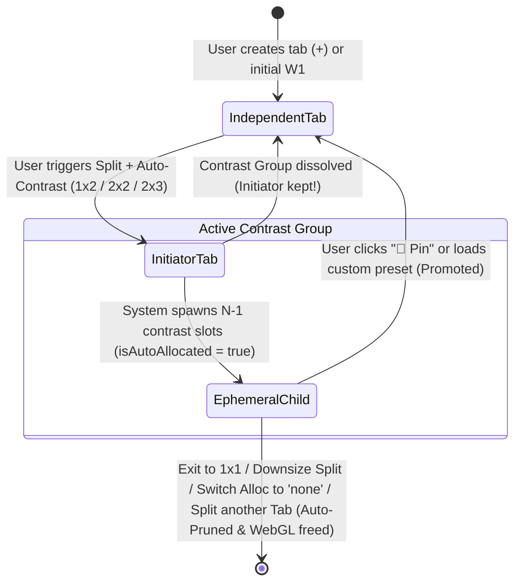
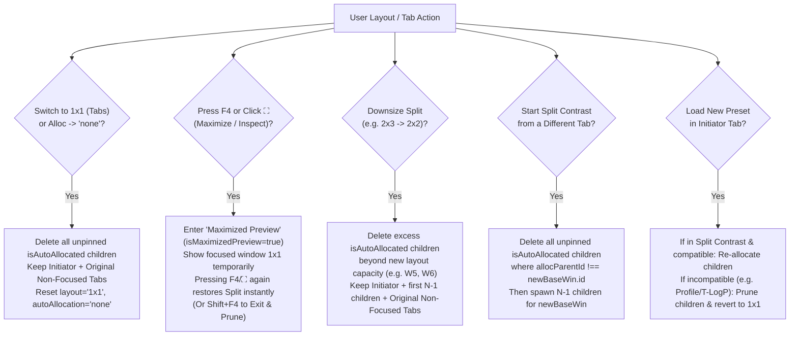

# Tab-to-Split Auto-Contrast: Tab Grouping, Lifecycle Cleanup, State Logic & UI/UX Design Proposal

## 1. Executive Summary & Root-Cause Diagnosis

MICAPS-Web's **Tab-to-Split Auto-Contrast** engine (`level`, `model`, `step`, `time`) allows forecasters to expand a single meteorological tab into `1×2`, `2×2`, or `2×3` comparison grids with one click. However, in real operational sessions, **the tab bar rapidly fills up with 6, 12, or 18+ residual tabs**, making tab navigation confusing, displacing the user's original tabs, and exhausting browser WebGL contexts.

### Why Tabs Rapidly Proliferate in the Current Codebase

An audit of [`tabsCore.js`](client/src/lib/stores/tabsCore.js), [`App.svelte`](client/src/App.svelte), [`NavBar.svelte`](client/src/components/NavBar.svelte), and [`TabsBar.svelte`](client/src/components/TabsBar.svelte) reveals **five interacting root causes**:

1. **No Auto-Pruning on Return to `1×1` or Layout Downsizing (`2×3` $\to$ `2×2` $\to$ `1×1`)**:
   - When expanding from `1×1` to `2×3`, [`prepareSplitWindows()`](client/src/lib/stores/tabsCore.js#L829-L998) creates up to 5 new window objects (`isAutoAllocated: true`, `allocParentId: targetBase.id`).
   - When returning to `1×1 (Tabs)` or downsizing from `2×3` (6 slots) to `2×2` (4 slots), [`handleChangeLayout()`](client/src/App.svelte#L553-L624) hides the extra panels via CSS (`class:hidden={!isVisible}`), **but never removes the auto-allocated windows from `activeTab.windows` or disposes their MapLibre instances**.
2. **`NavBar.svelte` Strips Auto-Allocation Provenance When Clicking `1×1 (Tabs)`**:
   - In [`NavBar.svelte` line 544](client/src/components/NavBar.svelte#L544), clicking `1x1 (Tabs)` calls `handleLayoutSelect("1x1", "none")`, which invokes `onSelectAutoAlloc("none")` **before** `onChangeLayout("1x1", "none")` ([`NavBar.svelte` lines 262–271](client/src/components/NavBar.svelte#L262-L271)).
   - Because `activeTab.layout` is still `"2x3"` when `onSelectAutoAlloc("none")` runs, [`handleSelectAutoAlloc("none")`](client/src/App.svelte#L999-L1001) executes `applyAutoAllocationModeToTab(activeTab, "none")` $\to$ [`revertAutoAllocation()`](client/src/lib/stores/tabsCore.js#L745-L790).
   - `revertAutoAllocation()` **wipes `win.isAutoAllocated = false` and `win.allocParentId = null` on every window** ([`tabsCore.js` lines 748–752](client/src/lib/stores/tabsCore.js#L748-L752)) and reloads all 6 windows to match the base window. Once `isAutoAllocated` is set to `false`, those 5 child tabs permanently become "user-created busy windows" (`busyWins`) and can **never** be reclaimed.
3. **Cross-Tab Split Sessions Treat Previous Auto-Allocated Children as `busyWins`**:
   - In [`prepareSplitWindows()`](client/src/lib/stores/tabsCore.js#L868-L876):
     ```javascript
     const isAllocForBase = Boolean(
       (w.isAutoAllocated && targetBase && w.allocParentId === targetBase.id) ||
       (tab.autoAllocation && tab.autoAllocation !== "none" && w.activeGroup?.id && targetBase?.activeGroup?.id && w.activeGroup.id === targetBase.activeGroup.id)
     );
     if (isWindowEmptyFn(w) || isAllocForBase) {
       emptyWins.push(w);
     } else {
       busyWins.push(w);
     }
     ```
   - If a user starts with **Tab 1** (`ECMWF 500hPa`) and **Tab 2** (`Surface Obs`), splits Tab 1 into `2×3` (+5 children linked to `Tab 1`), and later focuses **Tab 2** and splits Tab 2 into `2×3`, the 5 children of Tab 1 have `allocParentId === Tab1.id !== Tab2.id` and `hasWeatherLayers(w) === true`. They are classified as `busyWins`, so `prepareSplitWindows` spawns **5 more windows** (12 total). Splitting a third tab spawns **5 more** (17 total).
4. **Original Non-Focused Tabs Get Displaced on Every Split**:
   - Line 920 of [`tabsCore.js`](client/src/lib/stores/tabsCore.js#L919-L920) rewrites `tab.windows = [...splitWins, ...busyWins, ...unusedEmpty]`. Every time the user splits a tab, all original non-focused tabs (`busyWins`) are pushed to the far right of the tab bar (`W7`, `W8`, ...) and re-numbered.
5. **WebGL Context & Memory Exhaustion**:
   - [`App.svelte` lines 2314–2325](client/src/App.svelte#L2314-L2325) mounts a `<WindowPanel>` and a live MapLibre WebGL context for **every** entry in `activeTab.windows`, even when hidden. Chromium and Firefox enforce a hard limit of **16 active WebGL contexts per page**—meaning after three `2×3` contrast sessions without cleanup, the browser starts firing `webglcontextlost` and blanking maps.

---

## 2. Core Design Principles & Window Taxonomy

To solve tab proliferation while preserving the power of multi-window contrast, every window in `tab.windows` should have an explicit, unambiguous **lifecycle role**:

| Window Role | Identification Criteria | Lifecycle & Deletion Policy |
| :--- | :--- | :--- |
| **1. Initiator (Anchor) Tab** | `win.id === tab.allocAnchorId` (or `win` was focused when split-contrast started; `win.isAutoAllocated === false`) | **Always Preserved.** Remains the primary tab when exiting split-contrast or dissolving a contrast group. |
| **2. Original Non-Focused (Independent) Tab** | `win.isAutoAllocated === false && win.id !== tab.allocAnchorId` (created via `+` button or existed prior to split) | **Strictly Protected.** Never overwritten by auto-allocation, never deleted by contrast cleanup, and keeps its relative tab order. |
| **3. Ephemeral Contrast Child Tab** | `win.isAutoAllocated === true && win.allocParentId === initiator.id && !win.isPinned` | **Auto-Managed & Ephemeral.** Grouped under its Initiator tab; automatically deleted (`cleanupWindowResources`) when exiting contrast, downsizing layout, or starting a new contrast on another tab. |
| **4. Promoted (Pinned) Tab** | Was a Contrast Child, but user clicked **📌 Pin / Keep Tab** or manually loaded a new preset into it (`win.isAutoAllocated = false`, `win.isPinned = true`) | **Graduated to Independent Tab.** Detached from the contrast group and protected like an Original Non-Focused Tab. |



---

## 3. How to Group Contrast Tabs (Data Model & UI/UX Options)

### 3.1 Logical Grouping Data Model

Extend `tab` and `win` in [`tabsCore.js`](client/src/lib/stores/tabsCore.js) with explicit group ownership metadata:

```javascript
// On Tab object (createDefaultTab):
{
  id: 1,
  layout: "1x1",              // "1x1" | "1x2" | "2x2" | "2x3" | "3x2"
  autoAllocation: "none",     // "none" | "level" | "model" | "step" | "time"
  allocAnchorId: null,        // win.id of the Initiator tab that owns the current contrast session
  isMaximizedPreview: false,  // true when F4 / ⛶ temporarily maximizes one slot without destroying the split group
  _lastSplitLayout: "2x2",
  windows: [...]
}

// On Window object (createDefaultWindow):
{
  id: "tab-1-win-2",
  uid: 2,
  winIdx: 2,
  isAutoAllocated: true,      // true ONLY for system-spawned contrast children
  allocParentId: "tab-1-win-0", // ID of the Initiator tab
  allocMode: "level",         // "level" | "model" | "step" | "time"
  allocSlotIdx: 1,            // 1..5 slot offset relative to initiator
  allocBadgeText: "850 hPa",  // Short differential label for compact pill rendering
}
```

### 3.2 Three UI/UX Grouping Paradigms for `TabsBar.svelte`

We evaluate three UI patterns for representing the Initiator + Contrast Children alongside Original Non-Focused Tabs in [`TabsBar.svelte`](client/src/components/TabsBar.svelte):

| Criterion | **Option A: Chrome-Style Collapsible Tab Group** *(Recommended)* | **Option B: Single Master Tab with Inline Slot Chips** | **Option C: Flat Tabs with Color Badges (Status Quo + Prune)** |
| :--- | :--- | :--- | :--- |
| **Visual Structure** | Initiator + Children sit inside a unified `.tab-group-container` pill with a mode badge (`LEVEL ×4`), compact diff labels (`500`, `850`, `1000`, `200`), and a `[×]` dissolve button. | Only Independent Tabs appear in `TabsBar`. The Initiator tab expands horizontally to show mini sub-chips `[W1: 500 | W2: 850 | W3: 1000 | W4: 200 ✕]`. | Separate full-width tabs in `TabsBar`, differentiated only by a small icon or border color. |
| **Tab Bar Width Usage** | **Very Compact** (~320px for a 4-split group instead of ~720px), keeping Original Non-Focused Tabs visible without horizontal scrolling. | **Ultra Compact** (~260px), zero tab-bar clutter. | **Heavy Clutter** (6 tabs × 180px = 1,080px), pushes Original Non-Focused Tabs off-screen. |
| **Drag-and-Drop Reorder** | Supports dragging individual slots within the group **or** dragging Original Non-Focused Tabs around the group. | Harder to drag-reorder individual split slots in the tab bar. | Standard flat DnD, but easy to accidentally mix independent tabs into split slots. |
| **Mental Model** | Clear parent-child relationship; obvious how to collapse/close the contrast group vs. independent tabs. | Very clean, though sub-chips feel slightly different from standard tabs. | Confusing which tabs will be deleted when exiting split mode. |

---

### 3.3 Detailed Design of Recommended Option A: Compact Contrast Group in `TabsBar`

When a user has two original tabs—**Tab 1 (`ECMWF 500hPa HGT+WIND`)** and **Tab 2 (`Surface Obs Plot`)**—and initiates **`2×2 Multi-Level Contrast`** on **Tab 1**:

#### Before Split (`1×1` Tab Mode)
```text
┌────────────────────────────────────────────────────────────────────────────────────────┐
│ [ W1: 500hPa HGT+WIND (ECMWF) × ]  [ W2: Surface Plot [Obs: 08:00] × ]  [+]            │
└────────────────────────────────────────────────────────────────────────────────────────┘
```

#### During `2×2 Multi-Level Contrast` (Grouped & Compact Differential Pills)
Instead of repeating `"500hPa HGT+WIND [Valid: 09-27 08:00]"` four times and pushing `Surface Plot` off-screen, the Initiator (`W1`) and its 3 auto-allocated children (`W2–W4`) are rendered inside a **Contrast Group Capsule** (`.tab-contrast-group`), while the original non-focused tab (`W5: Surface Plot`) remains immediately visible alongside it:

```text
┌───────────────────────────────────────────────────────────────────────────────────────────────────────────────┐
│ ╭─ [◫ LEVEL] 500hPa HGT+WIND (ECMWF) ─────────────────────────────── [Collapse ✕] ─╮                          │
│ │ [★ W1: 500hPa]  [W2: 850hPa 📌×]  [W3: 1000hPa 📌×]  [W4: 200hPa 📌×]           │  [ W5: Surface Plot × ] [+]│
│ ╰──────────────────────────────────────────────────────────────────────────────────╯                          │
└───────────────────────────────────────────────────────────────────────────────────────────────────────────────┘
```

#### Key UX Affordances of the Contrast Group Capsule:
1. **Group Header / Badge (`[◫ LEVEL]` / `[⊞ MODEL]` / `[⏱ STEP]` / `[🕒 INIT]`)**:
   - Displays the active contrast axis and shared preset name once for the whole group.
2. **Initiator Anchor Indicator (`★ W1: 500hPa`)**:
   - The original tab that initiated the split has a subtle anchor/star badge (`★`) and no auto-allocated dashed border, signaling that **it is the permanent tab that will survive when the contrast group closes**.
3. **Differential Child Labels (`allocBadgeText`)**:
   - Because all windows in a contrast group share the same base preset, child pills only need to display their **differentiating parameter** (`win.allocBadgeText`):
     - **`level` mode**: `W2: 850 hPa`, `W3: 1000 hPa`, `W4: 200 hPa`, `W5: 700 hPa`, `W6: 925 hPa`
     - **`model` mode**: `W2: GRAPES_GFS`, `W3: GRAPES_3KM`, `W4: SHANGHAI_MR`, `W5: BEIJING_MR`, `W6: JAPAN_MR`
     - **`step` mode**: `W2: +030h`, `W3: +036h`, `W4: +042h`, `W5: +048h`, `W6: +054h`
     - **`time` mode**: `W2: 09-25 20Z (+36h)`, `W3: 09-25 08Z (+48h)`, etc.
   - Full titles (`W2: 850hPa HGT+WIND (ECMWF) [Valid: ...]`) still appear in the floating `WindowPanel` map header and on pill hover `title` tooltip.
4. **One-Click `[Collapse ✕]` (Dissolve Contrast Group) Button**:
   - Clicking `[Collapse ✕]` on the group capsule immediately deletes `W2, W3, W4` (freeing their WebGL contexts and memory), switches layout back to `1×1`, and leaves **only `[W1: 500hPa HGT+WIND]` (the Initiator) and `[W2: Surface Plot]` (the Original Non-Focused Tab)**!
5. **Per-Child `[📌]` (Pin / Promote) & `[×]` (Close Slot) Buttons**:
   - Clicking `📌` on `W2: 850hPa` promotes `W2` to a permanent independent tab (`isAutoAllocated = false`, moves it out of the ephemeral cleanup set next to `Surface Plot`).
   - Clicking `✓ Use This & Collapse` (or double-clicking a child's header with `Alt` / context menu `"Keep This & Close Split"`) applies `W2`'s parameter (`850 hPa`) to the Initiator tab `W1` and deletes all auto-allocated children!

---

## 4. Deletion & Lifecycle Management Rules

To guarantee that **only the original initiator tab and original non-focused tabs remain** after a contrast workflow (unless the user explicitly pins a child), the state manager should enforce **six deterministic lifecycle rules**:



### Rule 1: Exiting Split Contrast (`Layout -> 1x1 (Tabs)` or `[Collapse ✕]`)
- **What happens today**: Switches CSS to `1×1` and leaves all 5 auto-allocated tabs in `TabsBar`, plus runs `revertAutoAllocation` which strips `isAutoAllocated` and reloads all 5 hidden maps.
- **New behavior**:
  1. Identify all windows where `w.isAutoAllocated === true && !w.isPinned`.
  2. If the user currently has one of the auto-allocated child windows focused when clicking `1x1 (Tabs)`, focus returns to its Initiator tab (`allocParentId`) — or, if triggered via `"Keep Focused & Exit Split"`, copy the focused child's `level`/`model`/`period`/`forecastCycle` onto the Initiator tab before pruning.
  3. For each auto-allocated child window, call `cleanupWindowResources(w)` (destroying its MapLibre instance, layers, legends, and timeline store) and remove it from `tab.windows`.
  4. Re-index `winIdx` (`0..K-1`).
  5. **Result**: `tab.windows` contains **only the original Initiator tab and the original non-focused tabs**, in their exact original order. Zero zombie tabs, zero wasted WebGL contexts.

### Rule 2: Distinguishing Temporary Full-Screen Inspection (`F4` / `⛶`) vs. Exiting Split (`1×1`)
Forecasters frequently want to **temporarily zoom in on one panel of a `2×3` split** (e.g. inspecting 850 hPa wind barbs in `W2` full-screen for 5 seconds) and then **pop right back into the `2×3` split** without re-fetching 6 maps from the server.
- **Solution — Two-Tier Single-Window Toggle**:
  - **Temporary Maximize (`⛶` button in `WindowPanel` header or `F4` key)**:
    - Toggles `tab.isMaximizedPreview = !tab.isMaximizedPreview` while keeping `tab.layout = "2x3"` (or stores `_pausedSplitLayout = "2x3"`).
    - While maximized in preview mode, `WindowPanel` shows `⊡ Restore 2×3 Split (F4)` in the header, and the `TabsBar` group capsule shows a `[Paused 2×3 — Restore | ✕ Dissolve]` badge.
    - No tabs are deleted and no maps are destroyed, so pressing `F4` or `⊡` again restores the `2×3` grid in `<16ms`!
  - **Permanent Exit to Tabs (`Layout -> 1x1 (Tabs)` in `NavBar`, `[Collapse ✕]` in `TabsBar`, or `Shift+F4` / `Esc` in Maximized Preview)**:
    - Ends the contrast session and **deletes all auto-allocated child tabs**, keeping only the Initiator tab and Original Non-Focused tabs.

### Rule 3: Downsizing a Split Grid (`2×3` $\to$ `2×2` or `2×2` $\to$ `1×2`)
- **What happens today**: Switching from `2×3` (6 windows) to `2×2` (4 windows) leaves `W5` and `W6` hanging in `TabsBar` as hidden tabs.
- **New behavior**:
  - When downsizing from `prevNumVisible` (e.g. 6) to `numNeeded` (e.g. 4), any auto-allocated child windows (`w.isAutoAllocated === true`) outside the first `numNeeded` slots of the contrast group are **immediately pruned and cleaned up** via `cleanupWindowResources(w)`.
  - Original non-focused tabs (`w.isAutoAllocated === false`) are never touched.

### Rule 4: Switching to an Original Non-Focused Tab and Starting a New Split Contrast
- Suppose the user has `W1 (500hPa)` in a `2×2` split (`W1` + auto-children `W2, W3, W4`) and an original non-focused tab `W5 (Surface Obs)`.
- Scenario 4A: **User clicks `W5 (Surface Obs)` in `TabsBar` while in Split Mode**:
  - What should happen when the user clicks an original non-focused tab `W5` while `W1..W4` are in a `2×2` contrast split?
  - **Best UX**: Focusing an independent tab outside the active contrast group either:
    1. Automatically switches the view to `1×1` (or `isMaximizedPreview`) focused on `W5` so the user views `W5` cleanly at full size without corrupting the `W1..W4` contrast grid, **OR**
    2. If the user then triggers `Split Contrast` on `W5`, **all previous auto-allocated children of `W1` (`w.isAutoAllocated && w.allocParentId !== W5.id`) are automatically deleted first**, collapsing `W1` back to a single tab before `W5` spawns its own contrast children!
- This single invariant—**"At most ONE active ephemeral contrast group per workspace tab at a time"**—guarantees that `tab.windows` can never accumulate more than `(# of user-created tabs) + (max 5 ephemeral contrast slots)`.

### Rule 5: Switching Auto-Allocation Mode to `"none"` (`Alloc: none`)
- **Fix the `revertAutoAllocation` Trap**:
  - Today, [`revertAutoAllocation()`](client/src/lib/stores/tabsCore.js#L745-L790) keeps all 6 windows, overwrites their `level`/`model`/`period` to match `win0`, and sets `w.isAutoAllocated = false`. That leaves the user with **6 identical copies of the same map** and marks all 6 as permanent user tabs!
  - **New behavior**:
    - If the user selects `1x1 (Tabs)` or `Exit Contrast`, **delete** all `isAutoAllocated` children (`pruneAutoAllocatedWindows`).
    - If the user explicitly selects `2x2 Split -> Empty (none)` from `NavBar`, they want an independent 4-panel workspace: prune any excess `isAutoAllocated` children from a bigger split (e.g. `2x3` $\to$ `2x2`), and for the remaining slots that were `isAutoAllocated`, either clear them to empty slots or keep only independent user windows.

### Rule 6: Preserving Tab Bar Order of Original Non-Focused Tabs
- Instead of pushing `busyWins` to the end of `tab.windows` (`[...splitWins, ...busyWins]`), keep contrast children **grouped immediately after their Initiator tab**:
  - Suppose original tabs are `[Tab A, Tab B, Tab C]`.
  - User focuses `Tab B` and triggers `2×2 Multi-Model Contrast` (`Tab B` + 3 children `B_c1, B_c2, B_c3`).
  - `tab.windows` order becomes:
    `[Tab A, Tab B (Initiator), B_c1, B_c2, B_c3, Tab C]`
  - When `Tab B`'s contrast group is collapsed/pruned, `B_c1, B_c2, B_c3` are removed and `tab.windows` returns to the exact original order:
    `[Tab A, Tab B, Tab C]`!
  - Meanwhile, [`getVisibleWindows(tab)`](client/src/lib/stores/tabsCore.js#L395-L412) returns `[Tab B, B_c1, B_c2, B_c3]` for the grid viewport whenever `Tab B` or one of its children is active!

---

## 5. Concrete Code Architecture & Logic Changes

Below is the exact implementation blueprint for [`tabsCore.js`](client/src/lib/stores/tabsCore.js) and [`App.svelte`](client/src/App.svelte).

### 5.1 New Helper in `client/src/lib/stores/tabsCore.js`: `pruneAutoAllocatedWindows()`

```javascript
/**
 * Removes ephemeral auto-allocated contrast windows from `tab.windows`,
 * keeping the original initiator window and all independent (non-focused user) windows.
 *
 * @param {Object} tab - The active workspace tab state.
 * @param {Object} [options]
 * @param {string|null} [options.onlyForParentId=null] - If set, only prune children of this parent ID.
 * @param {string|null} [options.exceptParentId=null] - If set, prune children belonging to any OTHER parent ID.
 * @param {number} [options.keepCount=0] - Number of auto-allocated children of the active parent to retain (e.g. when downsizing 2x3 -> 2x2, keepCount = 3).
 * @param {Object|null} [options.promoteWin=null] - Optional child window whose state should be adopted by the initiator before pruning.
 * @param {(win: Object) => void} [options.onCleanupWindow=null] - Callback to release MapLibre, layers, legends, and timelines.
 * @returns {Object[]} Array of removed window objects.
 */
export function pruneAutoAllocatedWindows(tab, options = {}) {
  if (!tab || !Array.isArray(tab.windows) || tab.windows.length <= 1) return [];
  const {
    onlyForParentId = null,
    exceptParentId = null,
    keepCount = 0,
    promoteWin = null,
    onCleanupWindow = null,
  } = options;

  const activeWinBefore = tab.windows[tab.activeWinIdx] || tab.windows[0];

  // If promoting a child window's state onto its initiator before closing the split:
  if (promoteWin && promoteWin.isAutoAllocated && promoteWin.allocParentId) {
    const initiator = tab.windows.find((w) => w && w.id === promoteWin.allocParentId);
    if (initiator && initiator !== promoteWin) {
      initiator.level = promoteWin.level;
      initiator.model = promoteWin.model;
      initiator.period = promoteWin.period;
      initiator.forecastCycle = promoteWin.forecastCycle;
      initiator.obsTime = promoteWin.obsTime;
      initiator.stepLength = promoteWin.stepLength;
      if (promoteWin.activeGroup) {
        initiator.activeGroup = JSON.parse(JSON.stringify(promoteWin.activeGroup));
      }
    }
  }

  let keptChildrenForParent = 0;
  const survivors = [];
  const removed = [];

  for (const w of tab.windows) {
    if (!w) continue;
    const isEphemeral = Boolean(w.isAutoAllocated && !w.isPinned);
    if (!isEphemeral) {
      survivors.push(w);
      continue;
    }

    const matchesTarget =
      (onlyForParentId ? w.allocParentId === onlyForParentId : true) &&
      (exceptParentId ? w.allocParentId !== exceptParentId : true);

    if (!matchesTarget) {
      survivors.push(w);
      continue;
    }

    if (keepCount > 0 && keptChildrenForParent < keepCount) {
      keptChildrenForParent += 1;
      survivors.push(w);
    } else {
      removed.push(w);
    }
  }

  // Ensure at least 1 window always remains
  if (survivors.length === 0 && removed.length > 0) {
    const first = removed.shift();
    first.isAutoAllocated = false;
    first.allocParentId = null;
    first.allocMode = null;
    survivors.push(first);
  }

  for (const deadWin of removed) {
    if (typeof onCleanupWindow === "function") {
      try { onCleanupWindow(deadWin); } catch {}
    }
  }

  tab.windows = survivors;
  tab.windows.forEach((w, idx) => {
    w.winIdx = idx;
    if (w.title) w.title = String(w.title).replace(/^W\d+:\s*/, "");
    if (w.baseTitle) w.baseTitle = String(w.baseTitle).replace(/^W\d+:\s*/, "");
  });

  // Restore focus: if the previously focused window was an auto-allocated child that got pruned,
  // focus its initiator (allocParentId) rather than jumping to an arbitrary neighbor.
  if (activeWinBefore && survivors.includes(activeWinBefore)) {
    tab.activeWinIdx = survivors.indexOf(activeWinBefore);
  } else if (activeWinBefore?.allocParentId) {
    const parentIdx = survivors.findIndex((w) => w.id === activeWinBefore.allocParentId);
    tab.activeWinIdx = parentIdx !== -1 ? parentIdx : 0;
  } else {
    tab.activeWinIdx = Math.min(tab.activeWinIdx || 0, survivors.length - 1);
  }

  if (keepCount === 0 && !exceptParentId) {
    tab.allocAnchorId = null;
  }

  return removed;
}
```

### 5.2 Updating `getVisibleWindows(tab)` for Anchored Contrast Groups

When `tab.windows` keeps original non-focused tabs in their natural positions (e.g. `[Tab A (Surface), Tab B (500hPa Initiator), B_child1, B_child2, B_child3, Tab C (Radar)]`), `getVisibleWindows(tab)` in [`tabsCore.js`](client/src/lib/stores/tabsCore.js#L395-L412) should prioritize the active Contrast Group when in split mode:

```javascript
export function getVisibleWindows(tab) {
  if (!tab || !Array.isArray(tab.windows) || tab.windows.length === 0) return [];
  if (tab.layout === "1x1" || tab.isMaximizedPreview) {
    const active = tab.windows[tab.activeWinIdx] || tab.windows[0];
    return active ? [active] : [];
  }
  const numVisible = getNumVisible(tab.layout);
  const active = tab.windows[tab.activeWinIdx] || tab.windows[0];

  // If in an active auto-allocation contrast group, keep the group (Initiator + its children) together in the grid!
  const anchorId = active?.isAutoAllocated
    ? active.allocParentId
    : (tab.allocAnchorId && active?.id === tab.allocAnchorId ? active.id : null);

  if (anchorId) {
    const groupWins = tab.windows.filter(
      (w) => w && (w.id === anchorId || (w.isAutoAllocated && w.allocParentId === anchorId))
    );
    if (groupWins.length >= numVisible) {
      return groupWins.slice(0, numVisible);
    }
  }

  // Fallback for independent split mode (autoAllocation === "none")
  if (tab.windows.length <= numVisible) return [...tab.windows];
  if (!active) return tab.windows.slice(0, numVisible);
  const activePos = tab.windows.indexOf(active);
  if (activePos >= 0 && activePos < numVisible) {
    return tab.windows.slice(0, numVisible);
  }
  const others = tab.windows.filter((w) => w !== active).slice(0, numVisible - 1);
  return [active, ...others];
}
```

### 5.3 Fixing `NavBar.svelte` & `App.svelte` Layout Transitions

1. **In [`NavBar.svelte` lines 262–271](client/src/components/NavBar.svelte#L262-L271)**:
   Do **not** call `onSelectAutoAlloc(allocMode)` before `onChangeLayout(layoutKey, allocMode)`. `handleChangeLayout(layoutKey, allocMode)` in `App.svelte` already accepts `explicitAllocMode` as its second parameter! Calling `onSelectAutoAlloc("none")` while `layout` is still `"2x3"` was causing the unnecessary 6-window reload and stripping `isAutoAllocated` before `handleChangeLayout("1x1", "none")` could run.
   ```javascript
   function handleLayoutSelect(layoutKey, allocMode = null) {
     isLayoutMenuOpen = false;
     hoveredLayoutSubmenu = null;
     if (onChangeLayout) {
       onChangeLayout(layoutKey, allocMode);
     } else if (allocMode !== null && onSelectAutoAlloc) {
       onSelectAutoAlloc(allocMode);
     }
   }
   ```

2. **In [`App.svelte` `handleChangeLayout(layout, explicitAllocMode = null)`](client/src/App.svelte#L553-L624)**:
   - **Case 1: Switching to `1x1` (`!isSplit`)**:
     Prune all unpinned `isAutoAllocated` windows via `pruneAutoAllocatedWindows(activeTab, { onCleanupWindow: cleanupWindowResources })`, set `activeTab.autoAllocation = "none"`, `activeTab.isMaximizedPreview = false`, and focus the surviving Initiator window.
   - **Case 2: Switching to Split with `autoAllocation !== "none"`**:
     If `baseWin` is an `isAutoAllocated` child of an existing group, resolve `initiatorWin = getWindowById(baseWin.allocParentId) || baseWin`.
     First, prune any orphaned `isAutoAllocated` windows belonging to *other* parents (`exceptParentId: initiatorWin.id`), and if downsizing (e.g. `2x3` $\to$ `2x2`), prune excess children of `initiatorWin` (`keepCount: numNeeded - 1`).
     Then spawn/reuse `numNeeded - 1` children inserted directly after `initiatorWin`, leaving all Original Non-Focused Tabs in place!

---

## 6. UI / UX Design Specifications

### 6.1 `TabsBar.svelte` — Visual Grouping, Badges & Context Actions

```text
┌──────────────────────────────────────────────────────────────────────────────────────────────────────────────────┐
│  ╭─ ◫ LEVEL (4) ───────────────────────────────────────────────── [✕ Collapse] ─╮                                │
│  │ [★ W1: ECMWF 500hPa] [W2: 850hPa 📌] [W3: 1000hPa 📌] [W4: 200hPa 📌]         │  [W5: Surface Obs ×]  [+]      │
│  ╰──────────────────────────────────────────────────────────────────────────────╯                                │
└──────────────────────────────────────────────────────────────────────────────────────────────────────────────────┘
```

#### Visual & Interaction Details:
- **Group Container (`.tab-contrast-group`)**:
  - Subtle background tint `rgba(56, 139, 253, 0.07)` with a `1px solid rgba(88, 166, 255, 0.35)` top/side border and `border-radius: 6px 6px 0 0`.
  - **Mode Chip**: Compact pill on the left edge of the group showing:
    - `LEVEL` (Blue `#58a6ff`) for `multi-level-contrast`
    - `MODEL` (Purple `#bc8cff`) for `multi-model-contrast`
    - `STEP` (Green `#3fb950`) for `multi-step-contrast`
    - `TIME` / `INIT` (Amber `#d29922`) for `multi-time-contrast` / `multi-init-contrast`
- **Initiator Tab Pill (`.tab-item.is-initiator`)**:
  - Displays `★ W1: <Preset Short Title> (<Base Parameter>)`.
  - Does **not** have a close `×` button while it owns active contrast children (or clicking its `×` prompts/closes the entire contrast group).
- **Auto-Contrast Child Pills (`.tab-item.is-auto-child`)**:
  - Compact max-width (`110px` instead of `180px`), dashed bottom/side divider, displaying `W2: 850hPa` (or `W2: GRAPES_GFS`, `W2: +036h`).
  - Hovering reveals two micro-actions:
    - `📌` (**Pin as Independent Tab**): Sets `win.isAutoAllocated = false; win.isPinned = true;` and moves the tab out of the ephemeral group so it is preserved when exiting contrast.
    - `×` (**Close Slot**): Closes that specific window.
- **Group `[✕ Collapse]` Button (`.btn-collapse-group`)**:
  - Always visible on the right end of the group capsule.
  - One click calls `handleCollapseContrastGroup()`: deletes all `isAutoAllocated` children, frees their WebGL maps, sets `layout = "1x1"`, and focuses the Initiator tab (`W1`), while keeping `W5: Surface Obs` untouched.

### 6.2 `WindowPanel.svelte` — Floating Map Header Enhancements

In split mode, each sub-window has a floating glassmorphism `.win-header` pill at the top center ([`WindowPanel.svelte` lines 79–112](client/src/components/WindowPanel.svelte#L79-L112)). We recommend enhancing `.win-header` with role-aware controls:

```text
Initiator Window (W1):
  ╭────────────────────────────────────────────────────────────────────╮
  │ [★ W1]  500 hPa Height & Wind (ECMWF_HR) [Valid: 09-27 08:00]  [⛶] │
  ╰────────────────────────────────────────────────────────────────────╯

Auto-Allocated Child Window (W2):
  ╭──────────────────────────────────────────────────────────────────────────────╮
  │ [⚡ W2]  850 hPa Height & Wind (ECMWF_HR) [Valid: 09-27 08:00]  [📌] [✓] [⛶] │
  ╰──────────────────────────────────────────────────────────────────────────────╯
```

| Header Control | Appears On | Action & Tooltip |
| :--- | :--- | :--- |
| **Badge `[★ W1]`** (Blue/Green) | Initiator / Independent Tab | Indicates this is an original user tab that persists across split/tab transitions. |
| **Badge `[⚡ W2]`** (Cyan/Indigo) | Auto-Allocated Child (`win.isAutoAllocated`) | Indicates this is an auto-generated contrast slot. |
| **`[📌]` Pin Button** | Auto-Allocated Child | *"Pin as permanent tab (keep when exiting split)"* — converts `win.isAutoAllocated = false`. |
| **`[✓]` Adopt & Exit Button** | Auto-Allocated Child | *"Keep this view in main tab & close split"* — copies `W2`'s level/model/time to Initiator `W1`, deletes all auto-allocated children, and returns to `1×1`. |
| **`[⛶]` / `[⊡]` Maximize Preview** | All Split Windows | *"Temporarily maximize window (F4) — press again to restore split"* (toggles `isMaximizedPreview` without destroying the split group). |

### 6.3 Keyboard Shortcuts & Command Palette Integration

| Shortcut | Action | Behavior |
| :--- | :--- | :--- |
| <kbd>F4</kbd> or <kbd>Alt</kbd>+<kbd>S</kbd> | **Toggle Split / Maximized Preview** | If in Split mode, temporarily maximizes the focused window (`isMaximizedPreview = true`) or restores the split grid—**instant `<16ms` toggle with zero network requests**. |
| <kbd>Shift</kbd>+<kbd>F4</kbd> | **Exit Split Contrast & Prune Children** | Dissolves the contrast group, deletes all `isAutoAllocated` child tabs (`cleanupWindowResources`), keeps **only the Initiator tab + Original Non-Focused tabs**, and returns to `1×1`. |
| <kbd>Alt</kbd>+<kbd>P</kbd> | **Pin Focused Contrast Child** | Detaches the focused `isAutoAllocated` window from ephemeral cleanup so it becomes a permanent independent tab. |
| <kbd>Alt</kbd>+<kbd>Enter</kbd> (in Split) | **Adopt Focused Child & Collapse Split** | Applies the focused child window's level/model/step/time to the Initiator tab, deletes all auto-allocated children, and exits to `1×1`. |

---

## 7. Walkthrough of Key Operational Scenarios

### Scenario 1: Standard Contrast & Clean Exit (Keeping Initiator + Original Non-Focused Tab)
1. **Initial State (`1×1`)**:
   - Forecaster has **`W1`: `ECMWF 500hPa HGT+WIND`** (focused) and **`W2`: `Surface Synoptic Plot`** (non-focused).
2. **Initiate Contrast (`2×3 Multi-Level Contrast`)**:
   - `W1` becomes the **Initiator** (`tab.allocAnchorId = W1.id`).
   - 5 ephemeral children (`W1_c1`..`W1_c5` for `850, 1000, 200, 700, 925 hPa`) are inserted right after `W1` with `isAutoAllocated: true, allocParentId: W1.id`.
   - `TabsBar` shows: `╭─ [LEVEL] ★W1: 500 | W2: 850 | W3: 1000 | W4: 200 | W5: 700 | W6: 925 [✕ Collapse] ─╮` followed by `[W7: Surface Synoptic Plot]`.
3. **Exit Contrast (Clicks `[✕ Collapse]`, `Layout -> 1x1 (Tabs)`, or presses `Shift+F4`)**:
   - `pruneAutoAllocatedWindows()` destroys the 5 ephemeral children (`W2..W6`) and frees their 5 MapLibre WebGL contexts.
   - **Final State (`1×1`)**: Only **`W1`: `ECMWF 500hPa HGT+WIND`** (focused) and **`W2`: `Surface Synoptic Plot`** (non-focused) remain!

### Scenario 2: Switching Focus to Original Non-Focused Tab (`Surface Plot`) and Splitting It
1. While in `2×3 Multi-Level Contrast` on `W1`, the forecaster clicks `[W7: Surface Synoptic Plot]` and selects `2×2 Split -> Multi-Time Contrast`.
2. `prepareSplitWindows()` sees that `W1_c1..W1_c5` have `isAutoAllocated === true` and `allocParentId !== W7.id`.
3. Before creating `W7`'s 3 time-contrast children, `pruneAutoAllocatedWindows(tab, { exceptParentId: W7.id })` automatically deletes `W1_c1..W1_c5`.
4. **Result**: `W1 (ECMWF 500hPa)` collapses back to a single independent tab, and `W2 (Surface Synoptic Plot)` expands into a 4-window time-contrast group (`W2..W5`). Total windows: **5** (instead of 10).

### Scenario 3: Forecaster Finds a Feature in Child `W4 (200 hPa Jet)` and Wants to Keep It
- **Option 1 (Replace Initiator)**: Forecaster clicks `[✓]` (*Adopt & Exit*) on `W4 (200 hPa)`. `W1` adopts `200 hPa`, the 5 auto-allocated children are deleted, and the workspace returns to `1×1` with `W1 (ECMWF 200hPa)` + `W2 (Surface Plot)`.
- **Option 2 (Keep Both 500 hPa and 200 hPa)**: Forecaster clicks `[📌]` (*Pin*) on `W4 (200 hPa)`, then clicks `[✕ Collapse]`. The 4 unpinned children (`850, 1000, 700, 925 hPa`) are deleted, leaving **3 tabs**: `W1 (500 hPa)`, `W2 (200 hPa)`, and `W3 (Surface Plot)`.

---

## 8. Phased Implementation Plan

| Phase | Target Files | Key Deliverables |
| :--- | :--- | :--- |
| **Phase 1: Core Lifecycle & Auto-Pruning Logic** | [`client/src/lib/stores/tabsCore.js`](client/src/lib/stores/tabsCore.js)<br>[`client/src/App.svelte`](client/src/App.svelte)<br>[`client/src/components/NavBar.svelte`](client/src/components/NavBar.svelte) | 1. Implement `pruneAutoAllocatedWindows()` and `allocBadgeText` computation in `tabsCore.js`.<br>2. Fix `NavBar.svelte` `handleLayoutSelect("1x1", "none")` ordering bug.<br>3. Wire automatic pruning on `1x1` exit, layout downsizing (`2x3` $\to$ `2x2` $\to$ `1x2`), and parent-tab switching.<br>4. Preserve relative tab order of Original Non-Focused Tabs (`busyWins`). |
| **Phase 2: Grouped `TabsBar` UI & Compact Pills** | [`client/src/components/TabsBar.svelte`](client/src/components/TabsBar.svelte)<br>[`client/src/tabs.css`](client/src/tabs.css) | 1. Render `.tab-contrast-group` wrapper around Initiator + `isAutoAllocated` children.<br>2. Render short differential labels (`allocBadgeText`) on child pills.<br>3. Add `[✕ Collapse]` group action and per-child `[📌 Pin]` button. |
| **Phase 3: `WindowPanel` Header & Maximize Preview** | [`client/src/components/WindowPanel.svelte`](client/src/components/WindowPanel.svelte)<br>[`client/src/App.svelte`](client/src/App.svelte) | 1. Separate `F4` / `⛶` (`isMaximizedPreview` non-destructive inspect toggle) from `Shift+F4` / `1x1 (Tabs)` (destructive prune).<br>2. Add `[📌 Pin]` and `[✓ Adopt & Collapse]` buttons to auto-allocated child `.win-header`s. |
| **Phase 4: Unit & E2E Regression Tests** | [`client/test/stores/auto-allocation-modes.test.js`](client/test/stores/auto-allocation-modes.test.js) | Add test suite verifying:<br>- `1x1` $\to$ `2x3` $\to$ `1x1` leaves only Initiator + Original Non-Focused Tabs.<br>- `2x3` $\to$ `2x2` prunes exactly 2 child windows.<br>- Splitting Tab B after splitting Tab A prunes Tab A's children.<br>- Pinning a child tab (`isPinned = true`) protects it during group collapse. |
